# Minggu 6 — Authentication, Security & FCM

> Dokumentasi Praktikum Mata Kuliah **Pemrograman Mobile**.

[](https://dart.dev/)
[](https://flutter.dev/)
[](https://firebase.google.com/)
[](https://riverpod.dev/)
[](https://pub.dev/packages/go_router)

## 🧭 Ringkasan

Minggu keenam membahas autentikasi, penyimpanan kredensial secara aman, dan push notification menggunakan **Firebase Cloud Messaging (FCM)**. Project praktikum **Campus Notify** menggabungkan halaman login dan beranda kampus, route guard, simulasi siklus access/refresh token, Flutter Secure Storage, Dio interceptor, notifikasi lokal, token FCM, topic messaging, serta navigasi deep link menuju detail pengumuman.

Materi juga mencakup perbedaan notification payload dan data payload, permintaan permission pada Android/iOS, siklus hidup token perangkat, penanganan aplikasi foreground/background/terminated, refactoring, dan unit testing.

> **Status implementasi:** autentikasi dan penerbitan token pada source masih berupa mock. Base URL Dio menggunakan `https://example-campus-api.test`, sehingga request backend dan `POST /devices` belum terhubung ke server sungguhan. README ini membedakan materi jobsheet dari hal-hal yang benar-benar terintegrasi agar simulasi tidak disalahartikan sebagai layanan produksi.

## 🎯 Tujuan Pembelajaran

Setelah menyelesaikan praktikum ini, saya diharapkan mampu:

1. Memahami alur Firebase Auth, JWT, OAuth/Google Login, serta perbedaan ID, access, dan refresh token;
2. Menyimpan token sensitif menggunakan secure storage, bukan SharedPreferences;
3. Memahami auto-refresh access token setelah respons HTTP 401 dan penanganan sesi kedaluwarsa;
4. Menjelaskan arsitektur komunikasi FCM antara backend, Firebase, dan perangkat;
5. Meminta izin notifikasi dan mengelola registration token termasuk `onTokenRefresh`;
6. Membedakan notification payload dan data payload;
7. Menangani notifikasi saat aplikasi foreground, background, dan terminated;
8. Mengarahkan klik notifikasi ke deep link menggunakan GoRouter;
9. Memilih topic untuk siaran dan device token untuk pesan personal;
10. Menerapkan prinsip keamanan: tidak meng-hardcode secret atau mencetak token utuh;
11. Melakukan refactoring dan menguji logika aplikasi tanpa Firebase sungguhan.

## 🧰 Teknologi dan Tools

| Komponen | Penggunaan |
| --- | --- |
| **Dart** | Bahasa pemrograman aplikasi |
| **Flutter** | Framework UI lintas platform |
| **Firebase Core** | Inisialisasi Firebase |
| **Firebase Cloud Messaging** | Permission, token perangkat, dan push message |
| **Flutter Local Notifications** | Menampilkan notifikasi saat foreground |
| **Flutter Secure Storage** | Penyimpanan access token dan refresh token |
| **Dio** | HTTP client dan interceptor Authorization/refresh |
| **Riverpod** | Provider autentikasi dan dependency injection |
| **GoRouter** | Route guard dan deep link pengumuman |
| **flutter_test** | Unit test untuk parser route dan error mapping |
| **Firebase Console** | Konfigurasi project serta uji kirim FCM |
| **Visual Studio Code / Android Studio** | Editor, emulator, dan debugging |

## 📂 Struktur Folder

```text
06-Week-6-Authentication-Security-FCM/
├── README.md
├── Lib/
│   └── campus_notify/
│       ├── lib/
│       │   ├── main.dart                         # Firebase init, ProviderScope, GoRouter guard
│       │   ├── routes.dart                       # Konstanta route dan parser route payload
│       │   ├── data/
│       │   │   ├── api_client.dart                # Dio interceptor dan token refresh
│       │   │   ├── api_errors.dart                # Error jaringan menjadi pesan pengguna
│       │   │   ├── auth_repository.dart           # Login/refresh token mock
│       │   │   └── token_store.dart               # Secure storage access/refresh token
│       │   ├── messaging/push_service.dart        # Permission, FCM, local notification
│       │   ├── pages/
│       │   │   ├── login_page.dart                 # Form login
│       │   │   ├── home_page.dart                  # Home, token debug, kontrol topic
│       │   │   └── announcement_page.dart          # Tujuan deep link
│       │   └── providers/auth_provider.dart       # Auth state dan Dio provider
│       ├── test/widget_test.dart                  # Unit test parser route/error
│       ├── android/app/google-services.json        # Konfigurasi Firebase Android
│       ├── pubspec.yaml                            # Dependency project
│       └── analysis_options.yaml                   # Analyzer dan lint
└── Screenshots/                                    # Dokumentasi proses dan hasil
```

## 🚀 Cara Menjalankan

### Persyaratan

- Git;
- Flutter SDK dan Dart SDK;
- Visual Studio Code dengan ekstensi Flutter/Dart atau Android Studio;
- Android SDK, Android Emulator dengan Google Play Services, atau perangkat Android;
- Firebase project dengan Firebase Cloud Messaging aktif;
- Koneksi internet untuk Firebase dan backend (backend API pada source saat ini masih placeholder).

Verifikasi environment:

```bash
flutter --version
flutter doctor -v
flutter devices
```

Jika menggunakan Android, terima lisensi SDK:

```bash
flutter doctor --android-licenses
```

Untuk perangkat fisik, aktifkan **Developer options** dan **USB debugging**, sambungkan perangkat, izinkan debugging, lalu pastikan perangkat tampil pada `flutter devices`.

### Konfigurasi Firebase Android

Application ID project:

```text
com.example.campus_notify
```

File konfigurasi Firebase Android terletak di:

```text
Lib/campus_notify/android/app/google-services.json
```

Pastikan file berasal dari Firebase project yang benar dan package name terdaftar sebagai `com.example.campus_notify`. Jika memakai Firebase project sendiri, unduh konfigurasi yang sesuai dan gantikan file pada lokasi tersebut. Project telah menerapkan Google Services Gradle plugin.

Untuk iOS, daftarkan bundle identifier, tambahkan `GoogleService-Info.plist`, aktifkan Push Notifications dan Background Modes/Remote notifications di Xcode, serta konfigurasi APNs pada Firebase Console. Bukti praktikum yang tersedia terutama menunjukkan Android.

> File konfigurasi aplikasi Firebase bukan pengganti aturan keamanan backend. Jangan memasukkan service account key atau server key FCM ke aplikasi mobile.

### Menjalankan aplikasi

```bash
git clone https://github.com/FadhilTaufiqurrachman/244107020090-Mobile-Course.git
cd 244107020090-Mobile-Course/06-Week-6-Authentication-Security-FCM/Lib/campus_notify
flutter pub get
flutter devices
flutter run -d <device-id>
```

Ganti `<device-id>` dengan ID yang ditampilkan `flutter devices`, misalnya:

```bash
flutter run -d emulator-5554
```

Jika hanya satu target tersedia, gunakan `flutter run`. Setelah menambahkan plugin native atau mengubah Firebase/Gradle, lakukan full stop lalu jalankan ulang aplikasi; hot reload saja tidak selalu mendaftarkan plugin native baru.

### Menjalankan analisis dan test

Dari folder `Lib/campus_notify`:

```bash
flutter analyze
flutter test
```

## 🔐 Autentikasi dan Manajemen Token

### Tipe token

| Token | Fungsi | Penanganan |
| --- | --- | --- |
| **ID token** | Bukti identitas pengguna untuk diverifikasi backend; dapat berupa JWT | Backend memvalidasi issuer, audience, expiry, dan signature |
| **Access token** | Akses berumur relatif pendek ke resource API | Dikirim melalui `Authorization: Bearer ...` |
| **Refresh token** | Meminta access token baru tanpa login ulang | Rahasia berumur lebih panjang; simpan di secure storage, jangan log |

Detail token bergantung pada provider dan backend. ID token Firebase dan access token API tidak selalu dapat saling menggantikan; backend harus memverifikasi token yang diterbitkan untuk layanannya.

### AuthRepository pada source

`lib/data/auth_repository.dart` menyediakan `login()` dan `refresh()`, namun implementasinya masih **simulasi**:

- menunggu 500 ms saat login;
- memeriksa email mengandung `@` dan password minimal enam karakter;
- menghasilkan string `mock-access-for-...` dan `mock-refresh-for-...`;
- refresh menghasilkan access token mock baru setelah jeda singkat.

Komentar pada file menunjukkan tempat integrasi Firebase Auth atau provider nyata. String mock bukan JWT valid dan bukan autentikasi produksi.

### TokenStore dan secure storage

`TokenStore` menggunakan `FlutterSecureStorage` dan key `access_token` serta `refresh_token`. Method yang tersedia:

- `save(access, refresh)` menyimpan sesi;
- `readAccess()` dan `readRefresh()` membaca token;
- `clear()` menghapus sesi saat logout atau refresh gagal.

Gunakan secure storage yang memanfaatkan proteksi platform (Android Keystore/iOS Keychain). Jangan menyimpan refresh token di SharedPreferences dan jangan mencetak token penuh di log, analytics, atau screenshot.

### AuthNotifier dan route guard

`AuthNotifier` membaca access token ketika provider diinisialisasi, menyimpan token sesudah login sukses, dan menghapus token ketika logout. GoRouter mengamati `authStateProvider`:

- belum login → diarahkan ke `/login`;
- sudah login dan membuka `/login` → diarahkan ke `/`;
- status masih loading → redirect ditunda sampai pembacaan secure storage selesai.

| Path | Halaman |
| --- | --- |
| `/login` | Form login |
| `/` | Beranda kampus |
| `/pengumuman/:id` | Detail pengumuman |

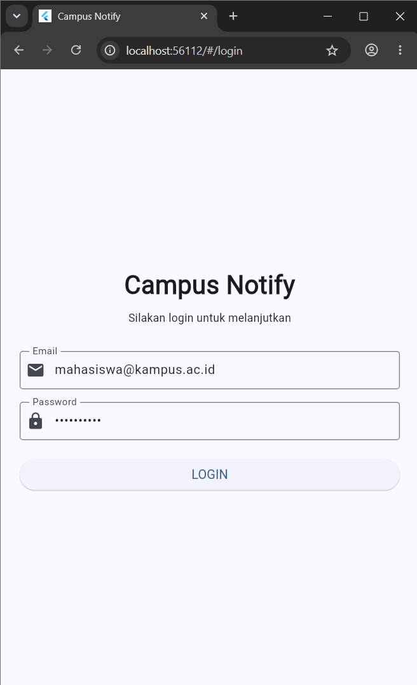

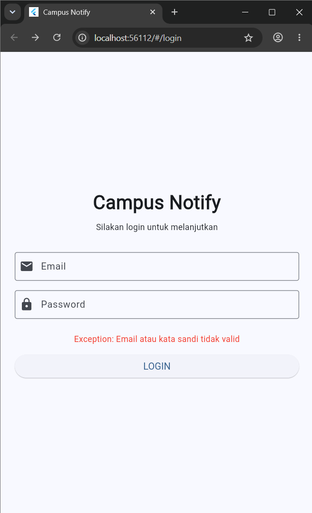

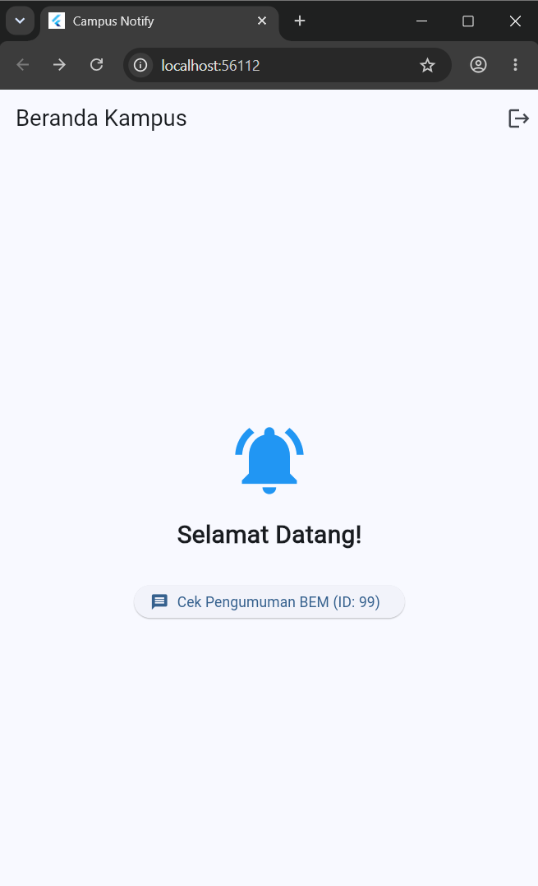

### Dio interceptor dan auto-refresh

`buildApiClient()` memasang interceptor untuk:

1. Membaca access token saat request dan menyisipkan Bearer header;
2. Mendeteksi respons 401;
3. Membaca refresh token dan meminta access token baru melalui `AuthRepository.refresh()`;
4. Menyimpan token baru dan mengulang request awal;
5. Menghapus token bila refresh gagal agar sesi tidak dipertahankan secara keliru.

**Batas integrasi:** `BaseOptions.baseUrl` pada source masih `https://example-campus-api.test`, sedangkan refresh memakai mock. Request nyata membutuhkan base URL, kontrak endpoint/token, dan server yang sesuai. Implementasi produksi juga perlu memastikan retry hanya sekali dan menghindari refresh request masuk ke interceptor secara rekursif.

`mapDioExceptionToUserMessage()` memetakan 401, timeout, offline, bad response, cancellation, serta error umum menjadi pesan yang lebih mudah dipahami pengguna.

## 🔔 FCM, Permission, dan Token Lifecycle

### Arsitektur FCM

```text
Flutter App → registration token → Backend aplikasi
Backend aplikasi → Firebase Admin/FCM API → Perangkat
```

Client meminta permission dan token FCM, kemudian menyerahkan token ke backend melalui HTTPS. Backend memakai FCM API untuk mengirim ke token perangkat atau topic. Kredensial server Firebase harus tetap di backend.

### Permission Android dan iOS

`requestNotificationPermission()` meminta izin alert, badge, dan sound.

- **Android 13+** memerlukan runtime permission `POST_NOTIFICATIONS`;
- **iOS** meminta otorisasi alert, badge, dan sound; status provisional juga mungkin diberikan.

Jika permission ditolak, aplikasi harus tetap menangani keadaan tersebut dengan baik. Pada Android, channel notifikasi diperlukan untuk mengelola perilaku dan prioritas notifikasi.

### Token FCM dan topic

`initFcmToken()` melakukan langkah berikut:

1. Mengambil token awal dengan `FirebaseMessaging.instance.getToken()`;
2. Memanggil callback `onToken` untuk mengirim token;
3. Memasang listener `onTokenRefresh`;
4. Subscribe ke topic `pengumuman-kampus`.

UI dan debug log memotong token menjadi maksimum 12 karakter lalu `...`. Token dapat berubah setelah reinstall, clear data, atau rotasi keamanan sehingga setiap token baru perlu diperbarui di backend.

**Batas integrasi:** `main.dart` mencoba `POST /devices`, tetapi Dio diarahkan ke URL placeholder dan kegagalan ditangani sebagai simulasi. Agar benar-benar meregistrasi perangkat, konfigurasi backend yang nyata dan asosiasi token dengan akun pengguna perlu ditambahkan.

| Target | Contoh penggunaan |
| --- | --- |
| **Topic** `pengumuman-kampus` | Perubahan jadwal umum, pemeliharaan SIAKAD, kegiatan kampus |
| **Device token** | Nilai/KHS, tagihan UKT, atau status KRS pribadi |

Data sensitif tidak boleh dikirim melalui topic publik.

## 📨 Payload dan Tiga App State

| Payload | Perilaku |
| --- | --- |
| **Notification** | Berisi title/body; sistem biasanya menampilkan saat background/terminated, tetapi foreground memerlukan penanganan aplikasi |
| **Data** | Key-value untuk logika aplikasi, misalnya `route` dan `id`; tidak otomatis menjadi banner |
| **Gabungan** | Notification + data: teks untuk pengguna sekaligus informasi deep link |

Contoh data payload:

```json
{"route": "/pengumuman/3", "id": "3"}
```

### Foreground

`FirebaseMessaging.onMessage` menerima pesan saat aplikasi terbuka. `push_service.dart` menampilkan local notification secara manual dengan `flutter_local_notifications`, Android channel `pengumuman`, serta route sebagai payload. Tap pada banner meneruskan route melalui callback ke GoRouter.

### Background

Saat aplikasi diminimize, notification payload dapat ditampilkan sistem. Tap ditangani oleh `FirebaseMessaging.onMessageOpenedApp`, lalu `data.route` diteruskan ke fungsi navigasi.

### Terminated

Saat aplikasi dibuka dari keadaan tertutup, `FirebaseMessaging.instance.getInitialMessage()` mengambil pesan pemicu. Startup menunggu `authStateProvider.future` selesai sebelum navigasi, sehingga route guard tidak salah menafsirkan status secure storage yang masih loading sebagai logout.

### Background handler dan BuildContext

Handler background adalah fungsi top-level:

```dart
@pragma('vm:entry-point')
Future<void> firebaseMessagingBackgroundHandler(RemoteMessage message) async {
  // Tidak memakai BuildContext atau state Riverpod UI.
}
```

Fungsi ini berjalan di isolate terpisah. Jangan mengakses `BuildContext`, widget, maupun state UI dari background handler. Push service menggunakan callback route agar messaging tidak bergantung langsung pada context widget.

| State | Cara uji | Hasil yang diharapkan |
| --- | --- | --- |
| Foreground | Buka aplikasi, kirim FCM dari Firebase Console | Local banner tampil dan tap membuka `/pengumuman/:id` |
| Background | Tekan Home/minimize, kirim FCM, tap system notification | Banner sistem tampil dan tap membuka route pengumuman |
| Terminated | Tutup aplikasi dari recent apps, kirim FCM, tap banner | Aplikasi terbuka, memulihkan auth state, lalu memproses deep link |

Jobsheet mencatat ketiga skenario berhasil pada perangkat uji. Screenshot tersedia di bawah.

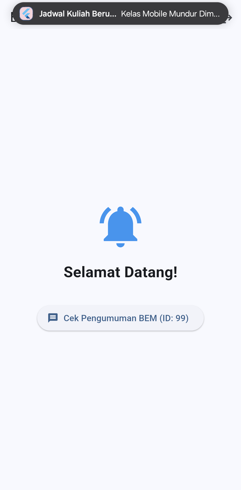

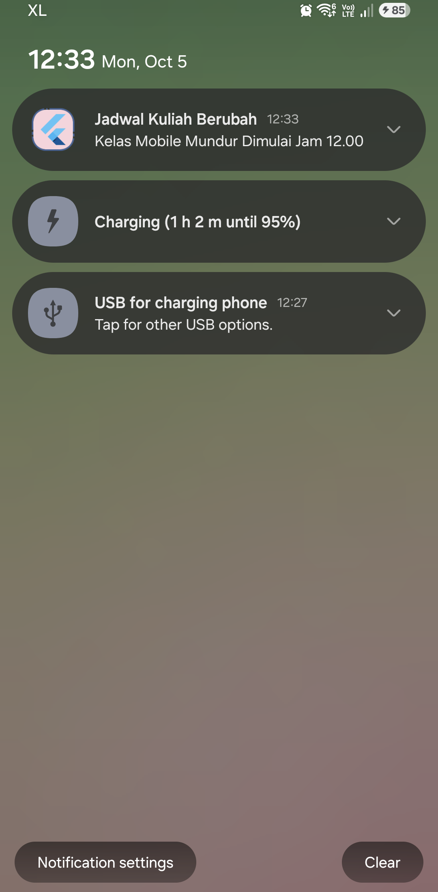

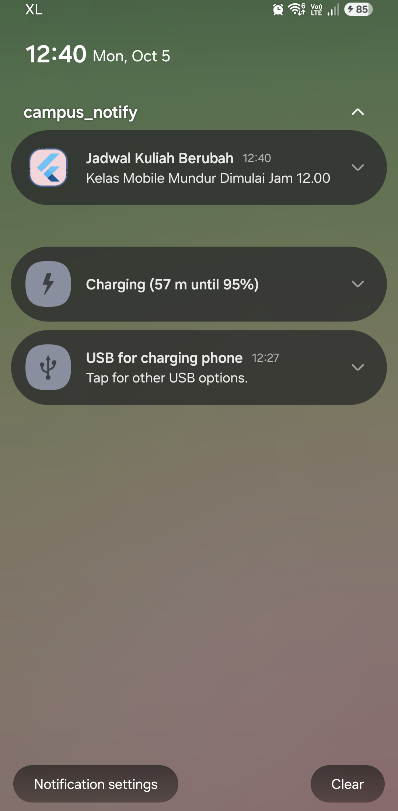

## 🧭 Refactoring dan Deep Link

Refactoring yang diterapkan:

1. **Konstanta route** dipusatkan di `lib/routes.dart`;
2. **`routeFromMessage()`** dibuat sebagai pure function agar dapat diuji tanpa Firebase;
3. **Error mapping** dipusatkan di `lib/data/api_errors.dart`;
4. **PushService** menggunakan callback navigasi, bukan `BuildContext`;
5. **GoRouter provider** menggunakan `refreshListenable` untuk merespons perubahan auth state;
6. **Startup deep link** menunggu pemulihan auth state untuk mencegah race condition.

Contoh route helper:

```dart
AppRoutes.announcementById('3') // /pengumuman/3
```

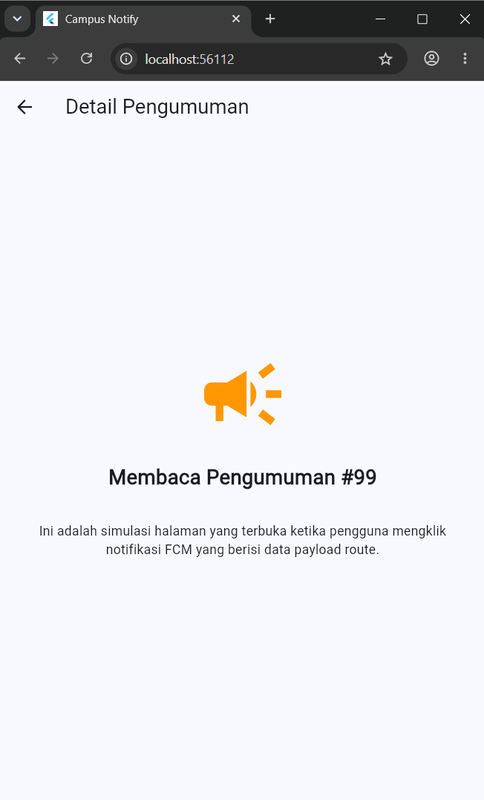

## 🤖 AI Challenge dan Verifikasi

Prompt AI meminta PushService dengan permission, `getToken`, `onTokenRefresh`, pengiriman token, local notification foreground, navigasi tap pada tiga app state, topic messaging, dan background handler.

| Area | Checklist verifikasi |
| --- | --- |
| Background handler | Top-level dengan `@pragma('vm:entry-point')`, tanpa BuildContext/Riverpod UI |
| Token lifecycle | Token baru dikirim ke backend, bukan hanya dicetak |
| Foreground | Local notification dibuat manual |
| Tap notification | Foreground, background, dan terminated menuju route yang benar |
| Startup guard | Auth state ditunggu sebelum initial deep link |
| Keamanan | Auth token di secure storage; token debug terpotong |
| Platform | Permission Android 13+, iOS/APNs, dan notification channel diperhatikan |

Jobsheet menjelaskan bahwa draf AI awal perlu diperbaiki pada pengiriman token backend, callback klik foreground, penanganan terminated yang beradu dengan auth loading, dan pembatasan token dalam log. Pada source repository, endpoint backend masih placeholder sehingga pengiriman token belum merupakan integrasi server nyata.

## 🧪 Testing dan Verifikasi

`test/widget_test.dart` menguji logika yang tidak memerlukan Firebase initialization:

- route kosong menghasilkan `/`;
- route tanpa slash awal dinormalisasi;
- route dengan slash dipertahankan;
- data payload dapat memuat route dan ID pengumuman;
- error Dio 401, timeout, dan offline dipetakan ke pesan pengguna;
- terdapat pemeriksaan sederhana atas token mock dan kondisi refresh kosong.

Pemeriksaan `FakeTokenStore` dalam test adalah logika sederhana, bukan fake yang diinjeksi ke seluruh AuthNotifier/interceptor. Test ini tidak menguji secure storage native, pengiriman Firebase, atau notifikasi end-to-end pada device. Uji tiga lifecycle FCM pada jobsheet dilakukan terpisah melalui perangkat dan Firebase Console.

Jalankan dari `Lib/campus_notify`:

```bash
flutter analyze
flutter test
```

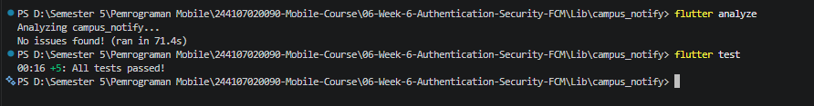

## 🧯 Error Umum dan Solusi

| Gejala | Penyebab umum | Solusi |
| --- | --- | --- |
| Token FCM `null` di emulator | Emulator tidak punya Google Play Services atau konfigurasi Firebase tidak cocok | Gunakan image emulator Play Store/perangkat fisik dan cocokkan package name |
| Banner tidak muncul saat foreground | Mengandalkan notifikasi sistem otomatis | Tangani `onMessage` dan tampilkan local notification |
| Tap terminated tidak navigasi | Initial message tidak ditangani atau router/auth belum siap | Panggil handler setelah startup dan tunggu auth state |
| Error 401 berulang | Request tidak diretry benar atau refresh gagal | Retry sekali setelah refresh; clear sesi dan login jika gagal |
| `MissingPluginException` | Hanya melakukan hot reload setelah menambah plugin native | Full stop, `flutter pub get`, lalu `flutter run` ulang |
| Notifikasi iOS tidak muncul | APNs/capability push belum dikonfigurasi | Atur APNs di Firebase dan Push Notifications/Background Modes di Xcode |
| `POST /devices` gagal | Base URL masih placeholder | Konfigurasikan endpoint backend nyata |

## 🖼️ Dokumentasi Screenshots

Seluruh 15 screenshot yang tersedia di folder `Screenshots/` dicantumkan di bawah.

### Project, autentikasi, dan aplikasi

| Dokumentasi | Bukti |
| --- | --- |
| Pembuatan project Flutter | 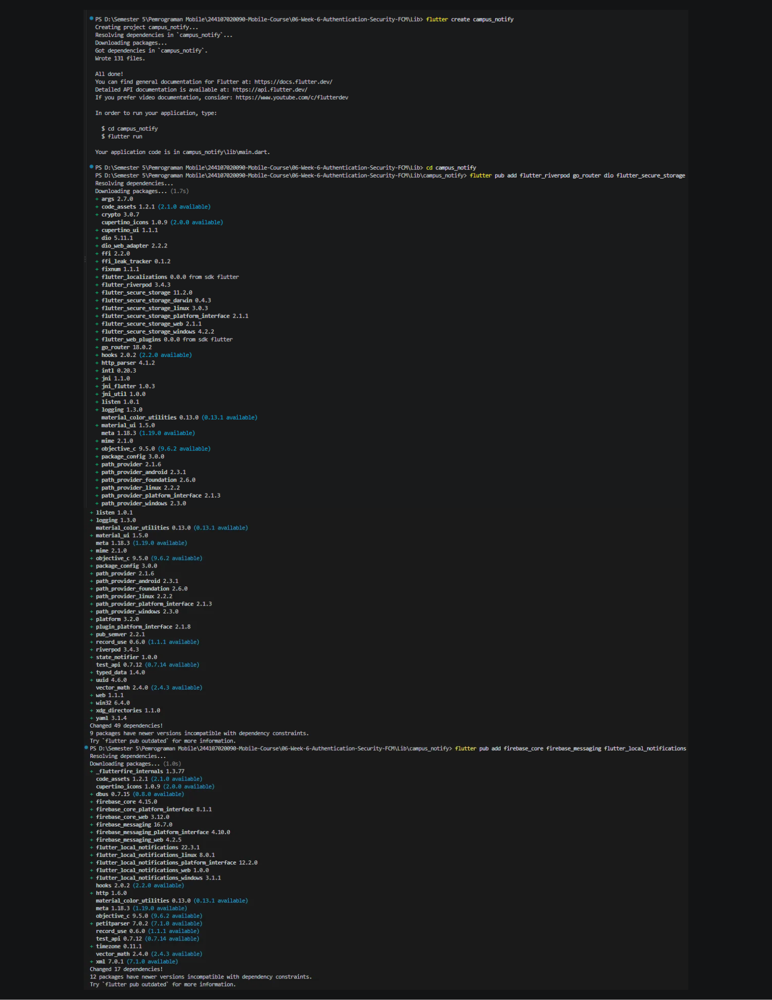 |
| Pembuatan project Firebase | 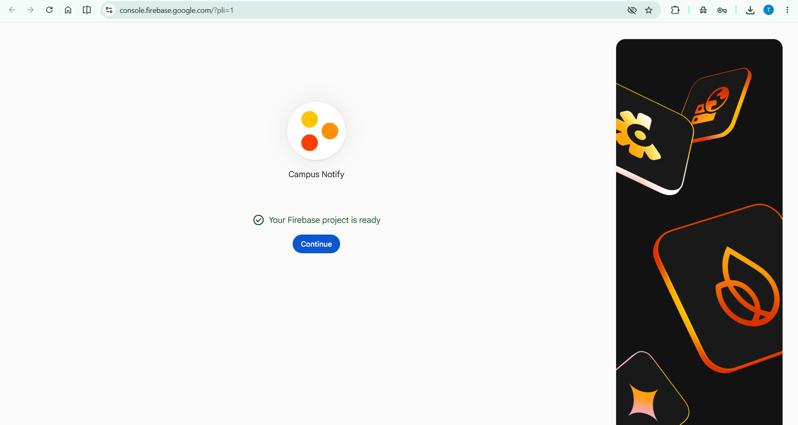 |
| Konfigurasi Firebase Android | 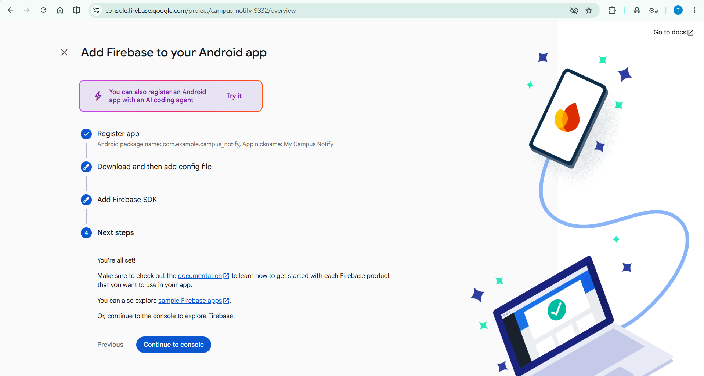 |
| Halaman login |  |
| Kegagalan autentikasi |  |
| Home kampus |  |
| Tampilan mobile | 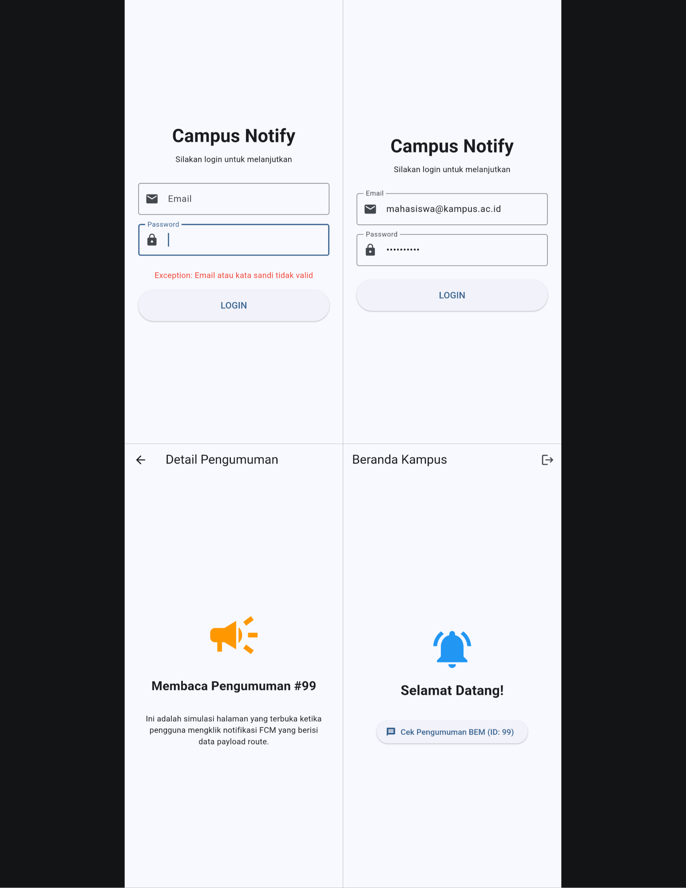 |
| Hasil Campus Notify | 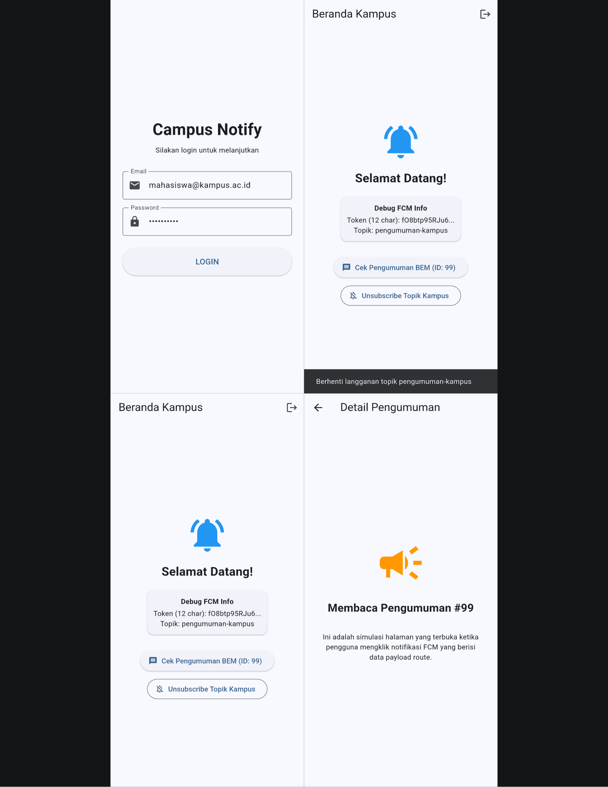 |
| Detail pengumuman |  |

### FCM dan verifikasi

| Dokumentasi | Bukti |
| --- | --- |
| Notifikasi foreground |  |
| Notifikasi background |  |
| Notifikasi terminated |  |
| Firebase background notification | 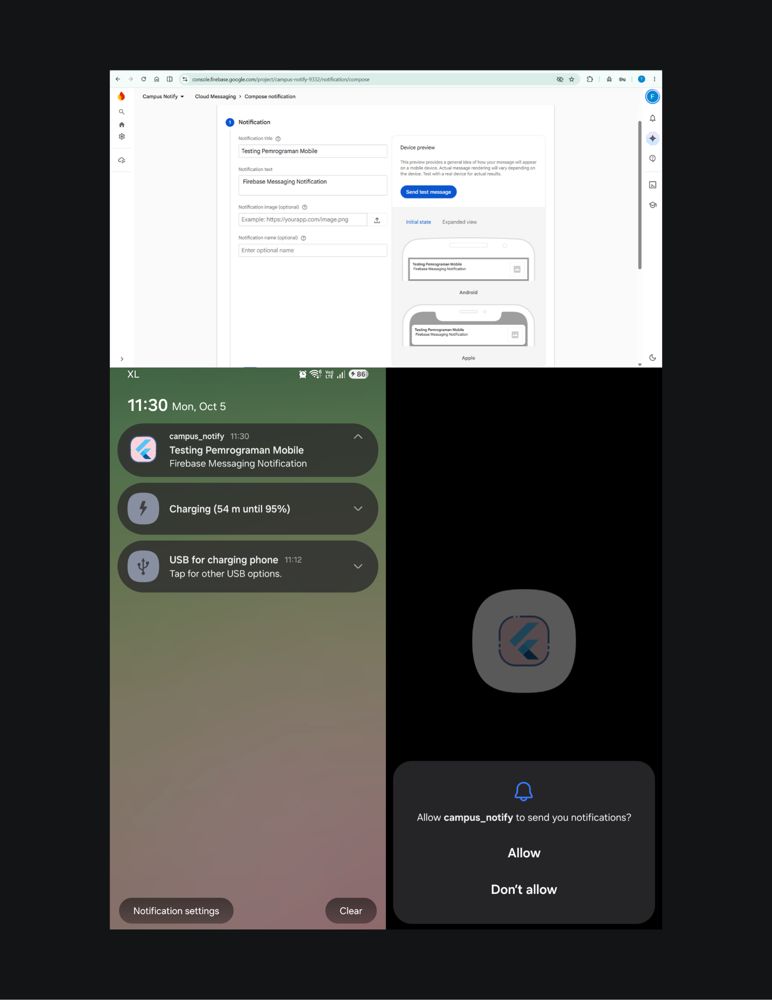 |
| Token refresh | 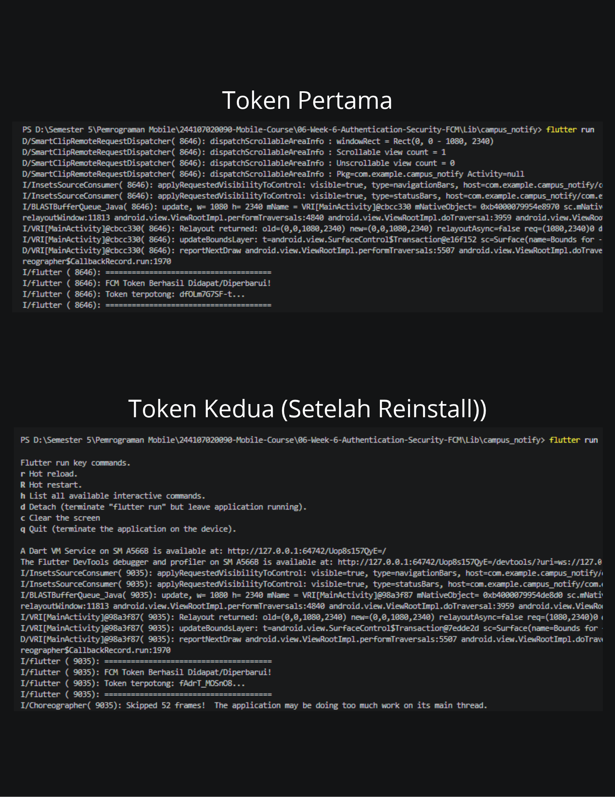 |
| Hasil Flutter analyze dan test |  |

## 📝 Refleksi

### 1. Mengapa refresh token tidak boleh disimpan di SharedPreferences, dan apa risikonya bila bocor?

SharedPreferences ditujukan untuk preferensi sederhana dan bukan penyimpanan rahasia terenkripsi. Refresh token biasanya berumur lebih panjang dan dapat digunakan untuk memperoleh access token baru tanpa meminta password. Jika dicuri, token tersebut berisiko mempertahankan sesi atau menyebabkan pengambilalihan akun. Karena itu token sensitif disimpan di secure storage yang memanfaatkan proteksi platform seperti Android Keystore atau iOS Keychain. Token juga tidak boleh dicetak utuh di log, analytics, atau screenshot.

### 2. Apa yang terjadi jika `onTokenRefresh` diabaikan selama satu semester?

Token FCM dapat berubah karena reinstall, clear data, pergantian perangkat, atau rotasi keamanan. Jika token baru tidak dikirim ke backend, backend mungkin menyimpan token lama yang tidak lagi valid. Akibatnya notifikasi ke perangkat tersebut gagal sampai token diperbarui. Listener `onTokenRefresh` harus meneruskan token baru ke backend dan backend perlu memperbarui asosiasi token dengan perangkat/pengguna.

### 3. Kapan menggunakan topic dan kapan menggunakan device token? Berikan contoh pesan kampus.

Topic cocok untuk broadcast yang relevan bagi banyak pengguna, seperti perubahan jadwal kuliah umum, pemeliharaan SIAKAD, atau kegiatan kampus melalui `pengumuman-kampus`. Device token digunakan untuk informasi pribadi yang hanya boleh diterima satu pengguna, seperti nilai/KHS, tagihan UKT, atau status KRS. Informasi sensitif tidak boleh dikirim ke topic publik.

### 4. Bagian mana dari draf AI yang diperbaiki atau diverifikasi, dan mengapa?

Bagian penting yang ditinjau adalah callback `onToken` agar mengirim token ke backend, bukan hanya mencetaknya; pemotongan token pada log; penghubungan tap local notification foreground ke GoRouter; dan penanganan initial deep link setelah auth state selesai dibaca. Background handler juga harus terpisah dari `BuildContext` dan state UI. Perubahan ini penting untuk menjaga kerahasiaan token, pemisahan tanggung jawab, serta mencegah race condition saat startup. Pada source yang tersedia, endpoint masih placeholder sehingga integrasi backend produksi tetap diperlukan.

### 5. Apa pembelajaran utama dari praktikum ini?

Autentikasi, penyimpanan token, dan push notification saling terkait, tetapi perlu dipisahkan tanggung jawabnya. Auth repository mengelola sesi, secure storage menyimpan kredensial, interceptor mengurus Bearer header dan refresh, sementara PushService menangani permission, token FCM, payload, dan siklus hidup aplikasi. Deep link harus memperhatikan kesiapan router serta pemulihan auth state. AI dapat membantu membuat kerangka, namun integrasi plugin, keamanan, dan hasil uji harus diverifikasi. Token mock dan placeholder API berguna untuk mempelajari alur, tetapi bukan pengganti backend produksi.

## 💡 Kesimpulan

Week 6 mengenalkan fondasi autentikasi aman dan push notification pada Flutter. Token auth harus disimpan secara aman, access token dapat diperbarui ketika kedaluwarsa, dan route dilindungi sesuai status sesi. FCM memerlukan permission serta pengelolaan lifecycle token, sedangkan klik notifikasi perlu diuji pada foreground, background, dan terminated. Project Campus Notify menyediakan kerangka pembelajaran tersebut, tetapi autentikasi/JWT dan backend device registration masih mock/placeholder dan harus diganti sebelum penggunaan produksi.

## 🔗 Referensi

- [Firebase for Flutter](https://firebase.google.com/docs/flutter/setup)
- [Firebase Cloud Messaging — Flutter client](https://firebase.google.com/docs/cloud-messaging/flutter/client)
- [FCM message types](https://firebase.google.com/docs/cloud-messaging/concept-options)
- [Flutter Secure Storage package](https://pub.dev/packages/flutter_secure_storage)
- [Firebase Messaging package](https://pub.dev/packages/firebase_messaging)
- [Flutter Local Notifications package](https://pub.dev/packages/flutter_local_notifications)
- [Dio package](https://pub.dev/packages/dio)
- [GoRouter package](https://pub.dev/packages/go_router)
- [Riverpod documentation](https://riverpod.dev/)
- [OWASP Mobile Application Security](https://mas.owasp.org/)
- [Flutter testing documentation](https://docs.flutter.dev/testing)

---

📌 **Repository:** [244107020090-Mobile-Course](https://github.com/FadhilTaufiqurrachman/244107020090-Mobile-Course)

👨‍💻 **Mahasiswa:** Fadhil Taufiqurrachman · **NIM:** 244107020090