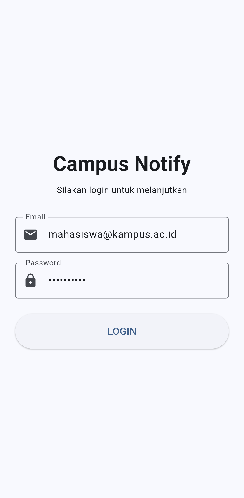
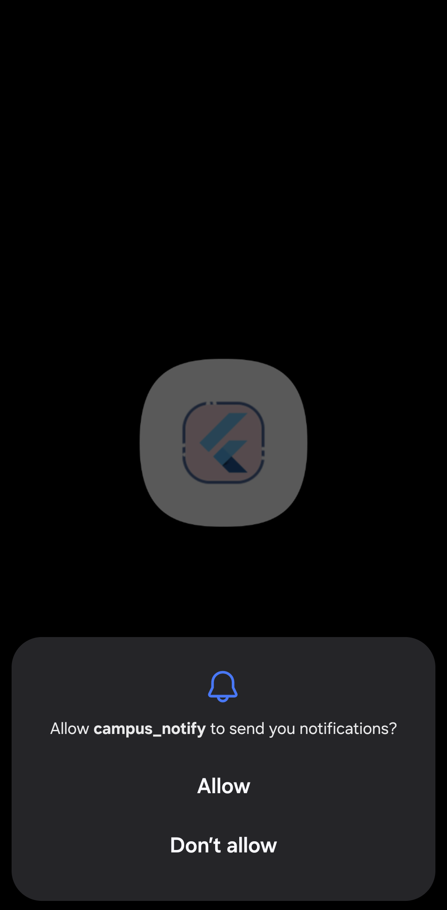
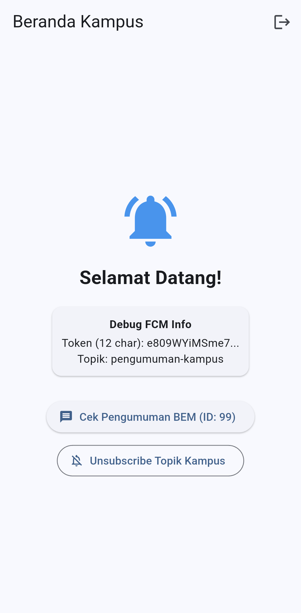
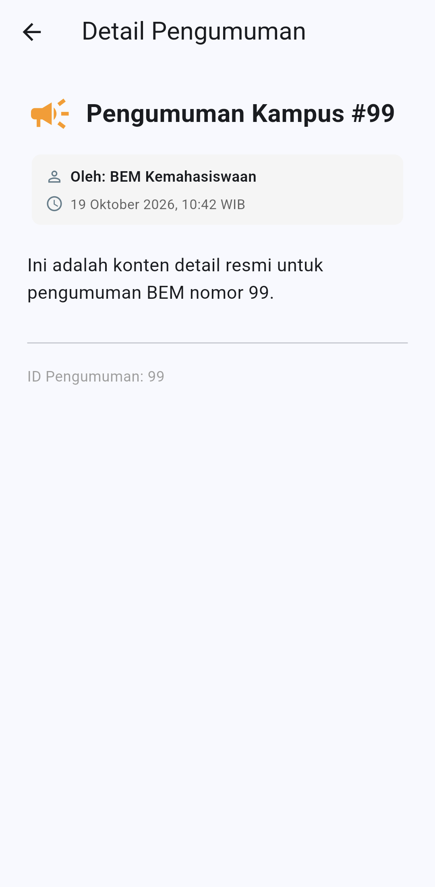
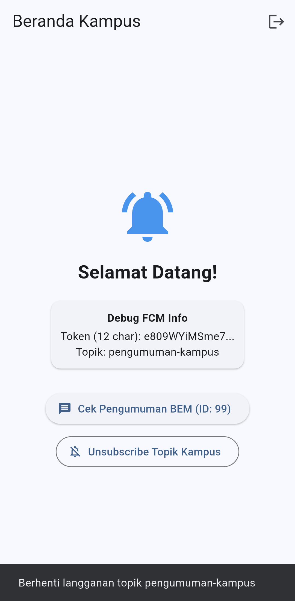
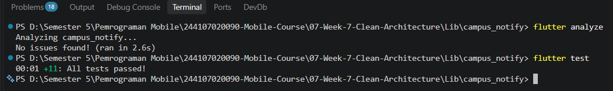

# Minggu 7 — Clean Architecture & Separation of Concerns

> Dokumentasi Praktikum Mata Kuliah **Pemrograman Mobile**.

[](https://dart.dev/)
[](https://flutter.dev/)
[](https://blog.cleancoder.com/uncle-bob/2012/08/13/the-clean-architecture.html)
[](https://riverpod.dev/)
[](https://pub.dev/packages/go_router)

## 🧭 Ringkasan

Minggu ketujuh membahas penerapan prinsip **SOLID** dan arsitektur perangkat lunak **Clean Architecture** pada aplikasi mobile Flutter. Project praktikum **Campus Notify** yang telah dibangun pada Minggu 6 direfaktor secara menyeluruh dari struktur lama yang terpusat dan bercampur (*mixed layer*) menjadi struktur **Feature-First** yang terisolasi dengan rapi.

Refactoring ini membagi sistem ke dalam tiga lapisan utama: **Presentation Layer**, **Domain Layer**, dan **Data Layer**, dengan aturan emas ketergantungan (*The Dependency Rule*) yang mengarah ke dalam. Seluruh kontrak repository dan entitas bisnis ditempatkan pada domain murni tanpa ketergantungan framework (bebas dari Flutter, Dio, SQLite, dan Firebase). Selain itu, dependency injection dikelola secara deklaratif menggunakan Riverpod, seluruh exception mentah dibungkus menjadi domain failure terstandarisasi, dan use case diuji menggunakan fake repository secara independen.

## 🎯 Tujuan Pembelajaran

Setelah menyelesaikan praktikum ini, saya diharapkan mampu:

1. Menjelaskan prinsip **SOLID** dan *Separation of Concerns* dengan contoh kode nyata pada Flutter;
2. Membedakan struktur *feature-first* vs *layer-first* beserta trade-off arsitekturalnya;
3. Menjelaskan tiga layer (`presentation`, `domain`, `data`) dan menegakkan aturan dependensi (*dependency rule* mengarah ke dalam);
4. Membedakan peran *entity* vs *model*, serta fungsi *repository contract*, *use case*, dan *dependency injection*;
5. Merefactor project Minggu 6 (`campus_notify`) menjadi struktur *feature-first* yang terpisah lapisannya;
6. Menguji use case domain menggunakan repository palsu (*fake repository*) tanpa database atau jaringan internet sungguhan;
7. Menilai trade-off arsitektur terhadap usulan AI (menghindari over-engineering untuk fitur CRUD sederhana);
8. Membuktikan sterilitas kode presentation dan domain menggunakan verifikasi statis dan grep.

## 🧰 Teknologi dan Tools

| Komponen | Penggunaan |
| --- | --- |
| **Dart (3.13.2)** | Bahasa pemrograman aplikasi, mendukung sealed classes dan records |
| **Flutter** | Framework UI lintas platform berbasis Material 3 |
| **Clean Architecture** | Pola arsitektur 3-layer berbasis domain murni |
| **Flutter Riverpod** | Dependency Injection dan state management deklaratif |
| **GoRouter** | Declarative routing, route guard, dan penanganan deep link |
| **Flutter Secure Storage** | Data source penyimpanan access token dan refresh token |
| **Dio** | HTTP network client dengan custom interceptor auto-refresh token |
| **Firebase Cloud Messaging** | Layanan push notifications dan topic messaging |
| **Flutter Local Notifications** | Penanganan notifikasi foreground lokal |
| **flutter_test** | Unit testing untuk use cases, domain logic, dan utilities murni |
| **Visual Studio Code / Android Studio** | Editor kode, emulator Android, dan debugging |

## 📂 Struktur Folder

```text
07-Week-7-Clean-Architecture/
├── README.md                                          # Laporan lengkap praktikum
├── Screenshots/                                       # Bukti dokumentasi hasil eksekusi
└── Lib/
    └── campus_notify/
        ├── lib/
        │   ├── main.dart                              # Inisialisasi Firebase, GoRouter guard, bootstrap
        │   ├── routes.dart                            # Rute navigasi & adapter parser payload
        │   ├── core/
        │   │   ├── failures.dart                      # Sealed class Failure domain murni Dart
        │   │   └── format.dart                        # Pure utilities (formatDateIndo, parseRoute)
        │   ├── features/
        │   │   ├── auth/                              # Fitur Autentikasi Pengguna
        │   │   │   ├── domain/
        │   │   │   │   ├── entities/auth_session.dart # Entity murni tanpa framework
        │   │   │   │   ├── repositories/auth_repository.dart # Interface kontrak abstrak
        │   │   │   │   └── usecases/login_usecase.dart # Operasi bisnis login
        │   │   │   ├── data/
        │   │   │   │   ├── datasources/token_store.dart # Adapter secure storage
        │   │   │   │   ├── models/auth_session_model.dart # Serializer model & mapper
        │   │   │   │   └── repositories/auth_repository_impl.dart # Implementasi repository
        │   │   │   └── presentation/
        │   │   │       ├── providers/auth_providers.dart # Riverpod DI & AuthNotifier
        │   │   │       └── pages/login_page.dart      # UI login steril
        │   │   └── announcements/                     # Fitur Pengumuman Kampus
        │   │       ├── domain/
        │   │       │   ├── entities/announcement.dart # Entity pengumuman murni
        │   │       │   ├── repositories/announcement_repository.dart # Interface kontrak
        │   │       │   └── usecases/get_announcement_detail.dart # Business use case
        │   │       ├── data/
        │   │       │   ├── models/announcement_model.dart # Model JSON mapper
        │   │       │   └── repositories/announcement_repository_impl.dart # Implementasi repo
        │   │       └── presentation/
        │   │           ├── providers/announcements_providers.dart # Riverpod DI wiring
        │   │           └── pages/
        │   │               ├── home_page.dart         # Beranda kampus steril
        │   │               └── announcement_page.dart # Detail pengumuman
        │   ├── messaging/
        │   │   └── push_service.dart                  # FCM background handler & local notification
        │   └── data/
        │       ├── api_client.dart                    # Dio builder berbasis interface AuthRepository
        │       └── api_errors.dart                    # Helper pemetaan DioException
        └── test/
            ├── core_format_test.dart                  # Unit test pure formatting & route parser
            ├── get_announcement_detail_test.dart      # Unit test domain use case pengumuman
            ├── login_usecase_test.dart                # Unit test domain use case login
            └── widget_test.dart                       # Unit test route, token, & error mapper
```

## 🚀 Cara Menjalankan

### Persyaratan

- Git;
- Flutter SDK (>= 3.47.0) dan Dart SDK (>= 3.13.0);
- Visual Studio Code dengan ekstensi Flutter/Dart atau Android Studio;
- Android SDK, Android Emulator dengan Google Play Services, atau perangkat Android fisik;
- Koneksi internet untuk unduhan package dependencies.

Verifikasi kesiapan environment:

```bash
flutter --version
flutter doctor -v
flutter devices
```

### Menjalankan Aplikasi

1. Clone repository portofolio dan arahkan ke direktori project:
   ```bash
   cd "07-Week-7-Clean-Architecture/Lib/campus_notify"
   ```
2. Pasang dependencies:
   ```bash
   flutter pub get
   ```
3. Jalankan aplikasi pada perangkat/emulator:
   ```bash
   flutter run
   ```

### Menjalankan Analisis Statis dan Pengujian Unit

Dari direktori `07-Week-7-Clean-Architecture/Lib/campus_notify`:

```bash
flutter analyze
flutter test
```

## 🏛️ Konsep SOLID dan Clean Architecture

### 1. SOLID dalam Satu Contoh Flutter

| Prinsip | Arti Praktis | Contoh Pelanggaran Nyata di Flutter |
| :--- | :--- | :--- |
| **S** - *Single Responsibility* | Satu kelas hanya punya satu alasan untuk berubah. | Widget 400 baris yang sekaligus fetch API, parsing JSON, format tanggal, dan render UI. |
| **O** - *Open/Closed* | Terbuka untuk ekstensi, tertutup untuk modifikasi langsung kode lama. | Menambah sumber data baru (misal Firebase) memaksa pengubahan widget yang sudah berjalan stabil. |
| **L** - *Liskov Substitution* | Pengganti (subclass/fake) harus bisa menggantikan aslinya tanpa merusak sistem. | Fake repository untuk testing melempar error yang tidak pernah didefinisikan oleh kontrak repository aslinya. |
| **I** - *Interface Segregation* | Jangan paksa consumer bergantung pada method yang tidak dipakainya. | Satu interface raksasa `AppRepository` yang memuat fungsi autentikasi, notifikasi, profil, dan KRS sekaligus. |
| **D** - *Dependency Inversion* | Bergantung pada abstraksi (interface), bukan implementasi konkret. | Notifier memanggil langsung `Dio()` atau `FlutterSecureStorage` tanpa melalui interface repository. |

### 2. Tiga Layer dan Aturan Dependensi

```text
Presentation Layer (Widget, Notifier, Router)
       │
       ▼  (bergantung ke)
Domain Layer (Entity, Repository Interface, Use Case, Failure)
       ▲
       │  (diimplementasikan oleh)
Data Layer (Model, Repository Impl, Data Sources: Dio / Secure Storage)
```

> **The Golden Dependency Rule:**
> Dependensi **hanya boleh mengarah ke dalam** (menuju layer `domain`).
> Layer `domain` tidak boleh tahu apa pun tentang Flutter framework, Dio, atau secure storage sehingga logika bisnis dapat diuji secara murni menggunakan unit test tanpa emulator.

### 3. Feature-First vs Layer-First

| Struktur | Pola Folder | Alasan Pemilihan pada Project Ini |
| :--- | :--- | :--- |
| **`feature-first`** | `lib/features/<fitur>/{data,domain,presentation}` | **Dipilih**: Setiap fitur (`auth` dan `announcements`) terisolasi mandiri, mudah dipahami, mudah ditambah atau dihapus tanpa menyentuh fitur lain. |
| **`layer-first`** | `lib/{data,domain,presentation}` terpusat global | Cepat untuk aplikasi sangat kecil (1 fitur), namun rentan kopling tinggi saat fitur berkembang. |

### 4. Kosakata Peran Komponen

* **Entity:** Objek bisnis murni di `domain` (tanpa metode serialisasi `toJson`/`fromJson`).
* **Model:** Representasi data mentah di `data` yang menyediakan mapping `toJson`/`fromJson` dan konversi `.toEntity()`.
* **Repository Interface:** Kontrak abstrak di `domain` yang mendefinisikan operasi bisnis yang dibutuhkan.
* **Repository Impl:** Implementasi konkret di `data` yang memenuhi kontrak dengan memanggil data source.
* **Use Case:** Kelas tunggal di `domain` untuk satu aksi bisnis spesifik (misal `LoginUseCase`), dipanggil oleh presentation.
* **Dependency Injection (DI):** Penyuntikan dependensi terpusat melalui Riverpod Provider.

## 🔍 Praktikum 1: Audit Layer Project Lama

### 1. Pemetaan File ke Layer (`campus_notify`)

Audit dilakukan terhadap kode awal Minggu 6 untuk memetakan penempatan file dan mendeteksi pelanggaran arsitektur:

| File Lama | Layer Awal | Masalah / Pelanggaran Arsitektural |
| :--- | :--- | :--- |
| `lib/pages/home_page.dart` | Presentation | Memanggil `unsubscribeCampusTopic()` langsung ke push service eksternal; komponen UI terikat dengan detail layanan. |
| `lib/pages/login_page.dart` | Presentation | Menampilkan string error mentah (`authState.error.toString()`) tanpa abstraksi domain failure. |
| `lib/pages/announcement_page.dart` | Presentation | Menampilkan simulasi detail statis tanpa representasi model/entitas bisnis. |
| `lib/main.dart` | Presentation / Bootstrap | **Memanggil instance Dio langsung** (`dio.post('/devices')`) di dalam UI lifecycle untuk registrasi token FCM. |
| `lib/providers/auth_provider.dart` | Presentation (State & DI) | **Instansiasi manual konkret** (`AuthRepository()`, `TokenStore()`) tanpa interface abstraksi domain. |
| `lib/data/auth_repository.dart` | Data (+ Kontrak Tercampur) | Kontrak (`interface`) dan implementasi menyatu dalam 1 kelas konkret. Entitas `AuthSession` berada di layer data. |
| `lib/data/token_store.dart` | Data (Data Source) | Menyentuh `FlutterSecureStorage` langsung tanpa kontrak pemisahan data source. |
| `lib/data/api_client.dart` | Data (Network) | Bergantung ketat pada implementasi konkret `TokenStore` dan `AuthRepository`. |
| `lib/data/api_errors.dart` | Data / Helper | Memetakan error langsung ke string UI alih-alih domain failure. |
| `lib/messaging/push_service.dart` | Infrastructure / Data | Interaksi langsung dengan plugin Firebase Messaging & Local Notifications. |
| `lib/routes.dart` | Navigation / Core | Rute navigasi dan fungsi parser payload notifikasi. |

### 2. Temuan Tiga Pelanggaran Klasik

1. **Widget yang Menyentuh Jaringan / Database Langsung:**
   * **Lokasi:** `lib/main.dart` (baris 113–117)
   * **Potongan Kode:**
     ```dart
     final dio = ref.read(apiClientProvider);
     await dio.post('/devices', data: {'fcm_token': token, 'platform': 'android'});
     ```
   * **Solusi:** Didelegasikan ke fungsi service `registerDeviceToken(token)` di layer infrastruktur.
2. **Logika Bisnis di dalam UI & Penanganan Error Mentah:**
   * **Lokasi:** `lib/pages/login_page.dart` (baris 64)
   * **Potongan Kode:**
     ```dart
     Text(authState.error.toString(), style: const TextStyle(color: Colors.red))
     ```
   * **Solusi:** Seluruh error ditransformasikan menjadi `AuthFailure` dengan pesan yang ramah pengguna.
3. **Instansiasi Manual (DI Bocor):**
   * **Lokasi:** `lib/providers/auth_provider.dart` (baris 7 & 10)
   * **Potongan Kode:**
     ```dart
     final tokenStoreProvider = Provider<TokenStore>((ref) => TokenStore());
     final authRepositoryProvider = Provider<AuthRepository>((ref) => AuthRepository());
     ```
   * **Solusi:** Provider diubah untuk mengembalikan interface `AuthRepository` domain murni.

### 3. Struktur Target Feature-First

Struktur target memisahkan fitur `auth` dan `announcements` secara mandiri dengan layer `domain`, `data`, dan `presentation` yang terisolasi.

## ⚙️ Praktikum 2: Domain dan Data per Fitur

### 1. Core Domain: Standardisasi Failure (`lib/core/failures.dart`)

Mencegah kebocoran exception teknis mentah (misalnya `DioException` atau `PlatformException`) ke layar UI:

```dart
sealed class Failure {
  const Failure(this.message);
  final String message;
}

class LocalFailure extends Failure {
  const LocalFailure(super.message);
}

class NetworkFailure extends Failure {
  const NetworkFailure(super.message);
}

class AuthFailure extends Failure {
  const AuthFailure(super.message);
}
```

### 2. Fitur `auth`

* **Entity Murni (`lib/features/auth/domain/entities/auth_session.dart`):**  
  Bebas dari import Flutter dan method mapping data.
  ```dart
  class AuthSession {
    const AuthSession({required this.access, required this.refresh, this.email});
    final String access;
    final String refresh;
    final String? email;
  }
  ```
* **Repository Interface (`lib/features/auth/domain/repositories/auth_repository.dart`):**  
  Menggunakan *Dart Record* untuk return sukses/gagal yang eksplisit:
  ```dart
  abstract class AuthRepository {
    Future<({AuthSession? session, Failure? failure})> login({
      required String email,
      required String password,
    });
    Future<({String? refreshedToken, Failure? failure})> refresh(String refreshToken);
  }
  ```
* **Use Case (`lib/features/auth/domain/usecases/login_usecase.dart`):**  
  Mengeksekusi operasi bisnis login secara spesifik.
* **Model (`lib/features/auth/data/models/auth_session_model.dart`):**  
  Menyediakan method `toJson()`, `fromJson()`, dan mapping `.toEntity()`.
* **Repository Impl (`lib/features/auth/data/repositories/auth_repository_impl.dart`):**  
  Mengimplementasikan kontrak interface dan membungkus error ke dalam `AuthFailure`.

### 3. Fitur `announcements`

* **Entity Murni:** `Announcement` (`id`, `title`, `content`, `author`, `createdAt`).
* **Repository Interface:** `AnnouncementRepository` dengan method `getAnnouncementById(String id)`.
* **Use Case:** `GetAnnouncementDetail`.
* **Model & Impl:** `AnnouncementModel` dan `AnnouncementRepositoryImpl`.

### 4. Pure Utilities (`lib/core/format.dart`)

Ekstraksi fungsi formatting murni tanpa ketergantungan pada widget context atau framework:
* `formatDateIndo(DateTime)`: Memformat tanggal ke format bahasa Indonesia (`... WIB`).
* `parseRouteFromMessage(Map<String, dynamic>)`: Mengekstrak rute navigasi dari payload data notifikasi.

## 🎨 Praktikum 3: Presentation, DI, dan Verifikasi

### 1. Dependency Injection Menggunakan Riverpod

Wiring seluruh dependensi dilakukan secara terpusat pada provider fitur masing-masing tanpa memerlukan library eksternal (seperti `GetIt`).

```dart
// Data Layer Provider
final tokenStoreProvider = Provider<TokenStore>((ref) => TokenStore());
final authRepositoryProvider = Provider<AuthRepository>((ref) => const AuthRepositoryImpl());

// Domain Layer Provider (Injeksi Interface ke Use Case)
final loginUseCaseProvider = Provider<LoginUseCase>((ref) {
  return LoginUseCase(ref.watch(authRepositoryProvider));
});

// Presentation Layer State Notifier Provider
final authStateProvider = AsyncNotifierProvider<AuthNotifier, bool>(AuthNotifier.new);
```

### 2. Halaman Hanya Membaca State

* **`LoginPage`:** Memantau `authStateProvider` untuk indikator loading, disabling input field saat proses, dan menampilkan error dari `AuthFailure`.
* **`AnnouncementPage`:** Menggunakan `ref.watch(announcementDetailProvider(id))` dengan pola `state.when(loading: ..., error: ..., data: ...)`. Tampilan card disusun responsif vertikal dengan icon pendukung sehingga bebas dari pixel overflow.
* **`HomePage`:** Berfungsi sebagai beranda steril yang memantau masked token FCM dan melakukan logout via provider.
* **`main.dart` Bootstrap:** Registrasi token FCM didelegasikan ke service layer, membebaskan presentation layer dari pemanggilan `Dio` langsung.

### 3. Verifikasi Dependency Rule

Tiga pemeriksaan sterilitas arsitektur dijalankan untuk membuktikan kepatuhan arsitektur:

1. **Presentation Steril dari Data Mentah (Nol Hasil):**
   ```bash
   rg "Dio\(|openDatabase|getDatabasesPath|FlutterSecureStorage|SharedPreferences\.getInstance|jsonDecode" lib/features/*/presentation lib/pages lib/main.dart
   ```
   *Hasil:* **0 temuan (Lolos)**.
2. **Domain Steril dari Framework & Package Luar (Nol Hasil):**
   ```bash
   rg "import 'package:flutter|import 'package:dio|import 'package:sqflite|import 'package:firebase" lib/features/*/domain lib/core
   ```
   *Hasil:* **0 temuan (Lolos)**.
3. **Analisis Statis & Unit Tests:**
   *Hasil:* `flutter analyze` bersih (0 issues) dan seluruh pengujian lulus.

## 🤖 AI Challenge: Reorganisasi Arsitektur & Trade-Off

### 1. Prompt AI yang Diajukan

```text
Project Flutter saya: campus_notify (auth + FCM + daftar pengumuman).
Kondisi kini: folder lib/{data, providers, pages, messaging},
repository tercampur dengan implementasi, widget memanggil Dio langsung.
Tugas:
1. Usulkan struktur feature-first Clean Architecture (presentation/domain/data) untuk fitur auth + announcements.
2. Untuk tiap file lama, sebutkan tujuan barunya (pindah/pecah/hapus).
3. Tandai bagian yang over-engineering bila diterapkan ke CRUD sederhana, dan kapan use case benar-benar dibutuhkan vs repository langsung.
4. Tunjukkan wiring DI dengan Riverpod (tanpa package DI tambahan).
Jelaskan trade-off setiap keputusan.
```

### 2. Tabel Pemetaan File Lama ke Tujuan Baru

| File Lama | Status Tindakan | Lokasi Baru | Alasan Arsitektural |
| :--- | :--- | :--- | :--- |
| `lib/data/auth_repository.dart` | **Dipecah** | `lib/features/auth/domain/entities/auth_session.dart`, `.../domain/repositories/auth_repository.dart`, `.../data/repositories/auth_repository_impl.dart` | Memisahkan kontrak abstrak domain dari implementasi konkret di layer data. |
| `lib/data/token_store.dart` | **Pindah** | `lib/features/auth/data/datasources/token_store.dart` | Menempatkan storage adapter pada data source lokal fitur auth. |
| `lib/data/api_client.dart` | **Refactor** | `lib/data/api_client.dart` | Bergantung pada interface `AuthRepository` domain, bukan implementasi konkret. |
| `lib/data/api_errors.dart` | **Digantikan** | `lib/core/failures.dart` | Standardisasi pesan error menjadi domain failure. |
| `lib/providers/auth_provider.dart` | **Dipecah** | `lib/features/auth/presentation/providers/auth_providers.dart` | Menggabungkan provider data, domain use case, dan notifier UI secara terstruktur. |
| `lib/pages/login_page.dart` | **Pindah** | `lib/features/auth/presentation/pages/login_page.dart` | Terisolasi di presentation layer fitur auth. |
| `lib/pages/home_page.dart` | **Pindah** | `lib/features/announcements/presentation/pages/home_page.dart` | Terisolasi di presentation layer fitur pengumuman. |
| `lib/pages/announcement_page.dart` | **Pindah & Refactor** | `lib/features/announcements/presentation/pages/announcement_page.dart` | Terhubung ke state provider dan formatting tanggal murni. |
| `lib/main.dart` | **Refactor** | `lib/main.dart` | Menghapus pemanggilan `dio.post` langsung di presentation. |
| `lib/messaging/push_service.dart` | **Tetap** | `lib/messaging/push_service.dart` | Mengelola FCM background isolate dan local notifications. |

### 3. Analisis Over-Engineering vs Kebutuhan Nyata Use Case

* **Potensi Over-Engineering:**  
  Pada operasi CRUD sederhana 1-baris (misal `getAnnouncementById`), membuat kelas Use Case terpisah menambah beban boilerplate (1 file baru, 1 class baru, 1 provider baru) tanpa nilai fungsional. Alternatif lebih ringkas bagi tim kecil adalah langsung memanggil repository melalui provider.
* **Kapan Use Case Benar-Benar Dibutuhkan:**
  1. Koordinasi antarbeberapa repository (misal: login memanggil API auth + simpan token ke secure storage + update analytics);
  2. Terdapat validasi atau logika bisnis murni (misal: filter status aktif, sanitasi input);
  3. Membutuhkan pengujian unit test independen tanpa menginstansiasi provider atau UI.

### 4. Tabel Keputusan Mahasiswa vs Usulan AI

| Aspek Keputusan | Usulan AI | Keputusan Mahasiswa | Justifikasi Teknis |
| :--- | :--- | :--- | :--- |
| **Lokasi Repository Interface** | Di dalam `domain/repositories/` | **Diterima** | Sesuai Dependency Inversion: domain menentukan kontrak, data mengimplementasikannya. |
| **Use Case pada CRUD Sederhana** | Membuat `GetAnnouncementDetail` use case | **Diterima Bersyarat** | Diterapkan demi keseragaman jobsheet, namun dicatat sebagai trade-off over-engineering. |
| **Penanganan Error** | Menggunakan Dart 3 Records `({T? data, Failure? failure})` | **Diterima** | Ringan dan native tanpa perlu package eksternal seperti `fpdart`. |
| **Manajemen Dependensi (DI)** | Menggunakan Riverpod murni | **Diterima** | Terikat lifecycle widget, mendukung scoped overrides saat testing, tanpa risiko singleton `GetIt`. |
| **Backward Compatibility** | Menghapus langsung file lama | **Ditolak (Dimodifikasi)** | File lama dipertahankan dengan re-export ke path baru agar route dan test lama tidak langsung rusak. |

### 5. AI Verification Checklist

- [x] Interface repository tinggal di `domain` dan implementasi di `data`.
- [x] `domain` bebas 100% dari import Flutter/Dio/SQLite/Firebase (dibuktikan via grep).
- [x] Evaluasi over-engineering use case CRUD 1-baris tercatat secara tertulis.
- [x] Entity bebas mapping (`toJson`/`fromJson` hanya ada di Model).
- [x] Wiring DI terpusat di provider, widget tidak pernah melakukan `new Repository()`.

## 🧪 Refactoring, Testing, dan Error Umum

### 1. Pengujian Unit Use Case dengan Fake Repository

Pengujian dilakukan murni pada layer domain tanpa memerlukan koneksi database SQLite atau internet sungguhan:

1. **`test/get_announcement_detail_test.dart`:**
   * Menguji use case `GetAnnouncementDetail` menggunakan `FakeAnnouncementRepository`.
   * Memvalidasi skenario data sukses dan penerusan `LocalFailure` saat data tidak ditemukan.
2. **`test/login_usecase_test.dart`:**
   * Menguji use case `LoginUseCase` menggunakan `FakeAuthRepository`.
   * Memvalidasi penerbitan `AuthSession` saat login berhasil dan `AuthFailure` saat kredensial salah.
3. **`test/core_format_test.dart`:**
   * Menguji fungsi formatting tanggal bahasa Indonesia (`formatDateIndo`) dan parser rute payload notifikasi.
4. **`test/widget_test.dart`:**
   * Menguji route parsing, deserialisasi data payload, serta interceptor error mapper.

### 2. Hasil Eksekusi Pengujian Otomatis

```text
Analyzing campus_notify...
No issues found! (ran in 3.1s)

00:00 +0: loading test/core_format_test.dart
00:00 +0: Core Pure Format & Route Parser Tests formatDateIndo memformat DateTime menjadi format teks bahasa Indonesia
00:00 +1: Core Pure Format & Route Parser Tests parseRouteFromMessage menangani route normal, route tanpa slash, dan route kosong
00:00 +2: GetAnnouncementDetail Use Case Tests Mengembalikan detail pengumuman dari repository palsu saat sukses
00:00 +3: GetAnnouncementDetail Use Case Tests Meneruskan Failure dengan aman tanpa melempar exception saat gagal
00:00 +4: LoginUseCase Tests Berhasil login dan mengembalikan AuthSession tanpa failure
00:00 +5: LoginUseCase Tests Mengembalikan AuthFailure tanpa melempar exception saat kredensial salah
00:00 +6: routeFromMessage menangani route kosong dan tanpa slash
00:00 +7: data payload membawa id pengumuman
00:00 +8: provider auth membaca status login dari token
00:00 +9: refresh gagal -> sesi dibersihkan (paksa login ulang)
00:00 +10: mapDioExceptionToUserMessage memetakan 401, timeout, dan offline
00:00 +11: All tests passed!
```

Seluruh 11 pengujian unit test **lulus 100%**.

### 3. Error Umum dan Solusinya

| Gejala Masalah | Penyebab Umum | Solusi yang Diterapkan |
| :--- | :--- | :--- |
| **Import cycle / circular dependency** | Presentation diimpor oleh data/domain, atau fitur saling mengimpor presentation. | Menegakkan Dependency Rule: dependensi satu arah (`presentation -> domain <- data`). Navigasi antar fitur memakai GoRouter string path, bukan import widget langsung. |
| **`The argument type 'Model' can't be assigned to 'Entity'`** | Repository Impl mengembalikan model langsung, padahal kontrak meminta entity. | Menggunakan method `.toEntity()` di repository implementation sebelum data dikembalikan ke domain/presentation. |
| **Provider `ref.watch` di luar widget/provider** | Panggilan DI ditulis di dalam method helper biasa atau constructor kelas. | Menjaga seluruh wiring DI Riverpod di dalam provider top-level (`Provider`, `FutureProvider`, `NotifierProvider`). |
| **Test butuh database / network sungguhan** | Use case diuji menggunakan `RepositoryImpl` konkret asli. | Mengimplementasikan `FakeRepository` yang mengimplementasikan interface kontrak domain murni untuk testing. |
| **Refactor merusak fitur yang sudah jalan** | Tidak ada snapshot commit dan langsung memindahkan file secara drastis. | Membuat snapshot commit awal, mempertahankan re-export sementara untuk file lama, serta menjalankan uji regression test. |

## 🖼️ Dokumentasi Screenshots

Seluruh 6 screenshot dokumentasi yang tersedia di folder `Screenshots/` dicantumkan di bawah:

| Dokumentasi | Bukti Tampilan |
| :--- | :--- |
| **Halaman Login** |  |
| **Izin Notifikasi (Permission Controller)** |  |
| **Halaman Beranda (Home Page)** |  |
| **Detail Pengumuman** |  |
| **Berhenti Langganan Topik (Unsubscribe)** |  |
| **Hasil Flutter Analyze dan Test (11/11 Lulus)** |  |

## 📝 Refleksi

### 1. Mengapa interface repository harus tinggal di domain, bukan di data? Apa yang rusak bila dibalik?

Berdasarkan *Dependency Inversion Principle (DIP)* dan aturan emas Clean Architecture (*The Dependency Rule*), dependensi hanya boleh mengarah ke dalam (menuju `domain`). Layer domain adalah pemegang aturan bisnis murni yang tidak boleh mengetahui implementasi teknis penyimpanan data atau pustaka jaringan pihak ketiga.

Jika interface diletakkan di layer data, maka layer domain harus mengimpor layer data untuk mendefinisikan use case. Hal ini melanggar arah dependensi dan memicu *circular dependency* ketika layer data mengimpor entity domain. Selain itu, domain menjadi rapuh (*fragile*): setiap pergantian pustaka (misalnya migrasi dari SQLite ke Hive, atau Dio ke Http) berpotensi memaksa perubahan pada kontrak domain. Pengujian unit murni pada domain juga menjadi tidak mungkin dilakukan secara independen.

### 2. Kapan use case benar-benar dibutuhkan, dan kapan repository langsung ke notifier sudah cukup?

Use case benar-benar dibutuhkan ketika:
1. Terdapat **koordinasi antarbeberapa repository** (misalnya alur login yang memerlukan validasi kredensial ke API, penyimpanan token ke secure storage, dan inisialisasi session user);
2. Terdapat **logika atau aturan bisnis spesifik** sebelum/sesudah data diambil (misalnya validasi format email domain kampus `@kampus.ac.id`, formatting data, aturan sinkronisasi offline-first, atau filtering pengumuman aktif);
3. Dibutuhkan **pengujian unit test domain murni** tanpa perlu menginstansiasi widget atau StateNotifier.

Sebaliknya, repository langsung ke notifier sudah cukup ketika operasi bisnis hanya berupa operasi *passthrough* / delegasi 1-baris tanpa transformasi data (misalnya sekadar mengambil detail pengumuman statis berdasarkan ID). Dalam kasus ini, notifier dapat langsung mengonsumsi `ref.watch(announcementRepositoryProvider)` untuk menghemat boilerplate kode dan menjaga kesederhanaan sistem.

### 3. Apa biaya over-engineering (use case per CRUD satu-baris) bagi tim kecil? Kapan biayanya sepadan?

Biaya over-engineering bagi tim kecil mencakup:
1. **Boilerplate & Beban Pemeliharaan:** Untuk satu fungsi pembacaan data sederhana, pengembang harus membuat 4–5 file terpisah (entity, repository contract, repository impl, use case, model, provider). Ini memperlambat kecepatan rilis produk (*time-to-market*).
2. **Beban Kognitif (*Cognitive Load*):** Anggota tim harus menelusuri banyak lapisan abstraksi hanya untuk memahami alur satu baris query sederhana.

Biaya tersebut sepadan saat aplikasi mulai tumbuh dalam skala besar (*enterprise scale*), tim pengembang bertambah banyak sehingga membutuhkan pembagian kerja paralel antarlayer yang jelas, atau ketika standar kepatuhan software mensyaratkan *100% domain unit test coverage* yang terisolasi dari UI dan framework.

### 4. Bagian mana dari usulan AI yang Anda tolak atau sederhanakan, dan mengapa?

Usulan yang ditolak dan dimodifikasi:
1. **Penghapusan Langsung File Lama:** AI mengusulkan untuk langsung menghapus file lama di `lib/data/` dan `lib/pages/`. Usulan ini ditolak dan disederhanakan dengan menyediakan **file re-export sementara** (`export 'features/...'`). Tujuannya adalah menjaga *backward compatibility* agar konfigurasi GoRouter dan tes integrasi lama tidak langsung rusak saat proses transisi refactoring bertahap.
2. **Pembuatan Use Case Tanpa Pertimbangan:** AI cenderung membuat kelas use case secara mekanis untuk seluruh metode repository. Kami menerima `GetAnnouncementDetail` semata untuk kepatuhan jobsheet, namun mencatatnya secara kritis sebagai bentuk *over-engineering* untuk operasi 1-baris tanpa logika bisnis.

### 5. Apa pembelajaran utama dari praktikum ini?

Clean Architecture bukan sekadar merapikan folder, melainkan menegakkan **arah panah ketergantungan**. Dengan membebaskan layer `domain` dari ketergantungan framework (Flutter, Dio, Firebase, SQLite), logika bisnis aplikasi menjadi tahan terhadap perubahan teknologi luar dan dapat diuji secara otomatis dalam hitungan milidetik. Dependency Injection menggunakan Riverpod memberikan kontrol penuh atas siklus hidup objek tanpa bahaya singleton tersembunyi.

## 💡 Kesimpulan

Week 7 memberikan pemahaman arsitektural yang kuat dalam membangun aplikasi mobile skala industri:
- Prinsip SOLID dapat diterapkan secara nyata pada Flutter melalui pemisahan Entity, Repository Interface, Use Case, dan Notifier;
- Struktur **Feature-First** memberikan modularitas tinggi di mana setiap fitur berdiri sendiri secara lengkap;
- Refactoring berhasil dilakukan tanpa mengubah perilaku aplikasi (*identical behavior*), dengan seluruh 11 unit test lulus hijau dan static analysis bersih dari isu.

## 🔗 Referensi

- [Flutter: App Architecture Guide](https://docs.flutter.dev/app-architecture/guide)
- [The Clean Architecture (Robert C. Martin)](https://blog.cleancoder.com/uncle-bob/2012/08/13/the-clean-architecture.html)
- [Riverpod Documentation: Providers & Dependency Injection](https://riverpod.dev/docs/concepts/providers)
- [Dart 3: Records and Patterns](https://dart.dev/language/records)
- [GoRouter Package](https://pub.dev/packages/go_router)
- [Flutter Testing Guide](https://docs.flutter.dev/testing)

---

📌 **Repository:** [244107020090-Mobile-Course](https://github.com/FadhilTaufiqurrachman/244107020090-Mobile-Course)

👨‍💻 **Mahasiswa:** Fadhil Taufiqurrachman · **NIM:** 244107020090
