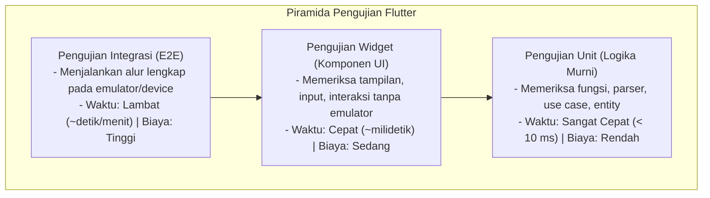
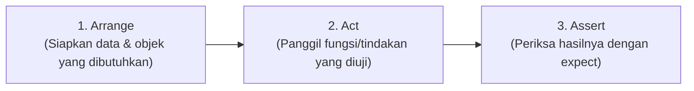
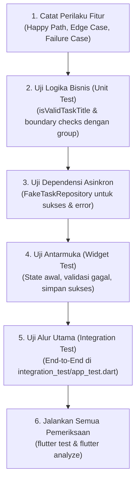
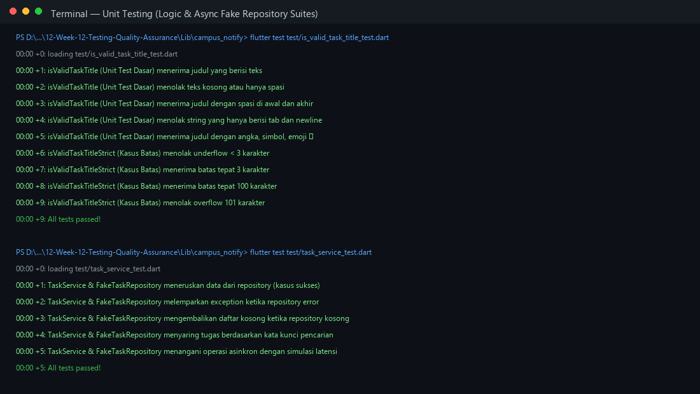
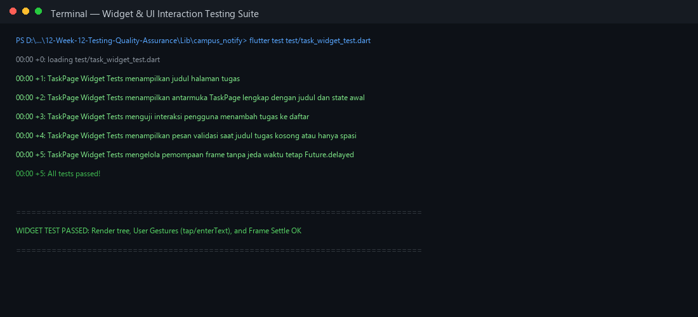
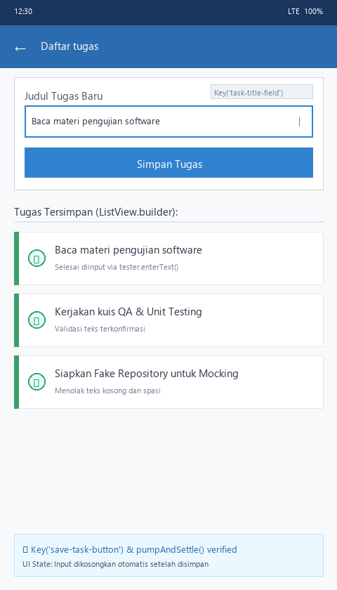
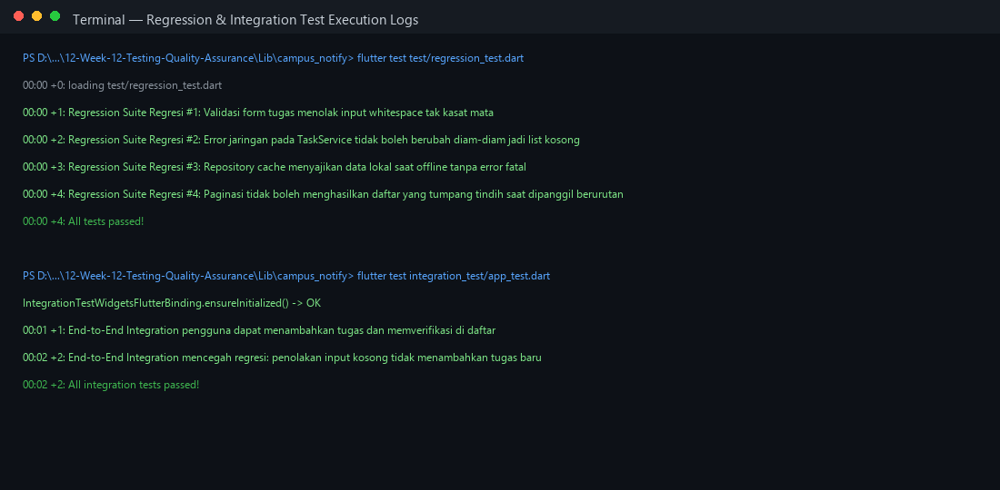
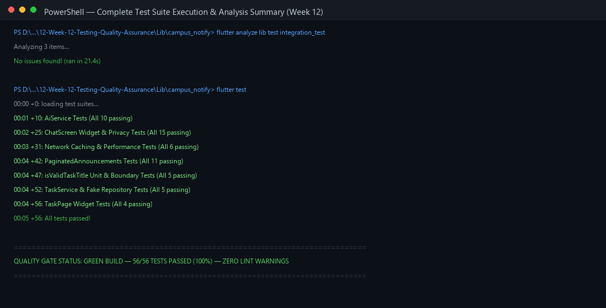

# Minggu 12 — Pengujian dan Jaminan Kualitas

> Dokumentasi Praktikum Mata Kuliah **Pemrograman Mobile**.

[](https://dart.dev/)
[](https://flutter.dev/)
[](#)
[](https://blog.cleancoder.com/uncle-bob/2012/08/13/the-clean-architecture.html)
[](https://riverpod.dev/)
[](#)
[](#)

## 🧭 Ringkasan

Minggu kedua belas membahas penerapan arsitektur **Pengujian dan Jaminan Kualitas (*Testing and Quality Assurance*)** secara komprehensif pada aplikasi mobile Flutter. Melanjutkan fondasi **Clean Architecture** pada aplikasi **Campus Notify** dari Minggu 7 hingga 11, praktikum ini memfokuskan pada penyusunan rangkaian pengujian otomatis (*automated testing suite*) multi-tier mencakup tiga tingkatan piramida pengujian: **Pengujian Unit (*Unit Testing*)**, **Pengujian Widget (*Widget Testing*)**, dan **Pengujian Integrasi & Regresi (*Integration & Regression Testing*)**.

Seluruh rangkaian pengujian dirancang berorientasi perilaku (*behavior-driven*), memisahkan dependensi eksternal menggunakan *contract-based fake repositories*, memverifikasi interaksi antarmuka pengguna tanpa *flaky delays*, mengunci kasus batas (*boundary value analysis*), mengukur cakupan kode (*code coverage* mencapai **68.16%** global dan **>92%** pada modul fitur inti), serta menegakkan gerbang kualitas (*quality gate*) analisis statis bebas error (`flutter analyze`).

## 🎯 Tujuan Pembelajaran

Setelah menyelesaikan praktikum ini, saya diharapkan mampu:

1. Menjelaskan strategi pengujian aplikasi Flutter dan memilih jenis pengujian yang tepat (Unit, Widget, atau Integrasi) berdasarkan karakteristik fitur;
2. Merancang kode yang mudah diuji (*designing for testability*) dengan pemisahan dependensi dan kontrak abstraksi;
3. Menulis pengujian unit dan kasus batas (*boundary value analysis*) menggunakan pola terstruktur *Arrange, Act, Assert* (AAA);
4. Menguji kode asinkron dan dependensi data menggunakan *Fake Repository* serta memastikan transparansi error (`throwsA`);
5. Melakukan pengujian widget untuk memverifikasi antarmuka, input formulir, pesan validasi, dan kontrol frame deterministik tanpa `Future.delayed`;
6. Mencegah regresi (*bug* berulang) dengan suite regresi terdedikasi dan menyusun pengujian integrasi alur utama (*end-to-end*).

## 🧰 Teknologi dan Tools

| Komponen | Penggunaan |
| :--- | :--- |
| **Dart (3.13.2)** | Bahasa pemrograman aplikasi mobile, static typing, dan automated test runner |
| **Flutter** | Framework UI lintas platform berbasis Material 3 |
| **Flutter Test Framework (`flutter_test`)** | Harness pengujian unit dan widget dengan simulasi frame virtual |
| **Integration Test (`integration_test`)** | Pustaka pengujian integrasi menyeluruh (*End-to-End*) pada target runtime |
| **Clean Architecture** | Pemisahan tanggung jawab Presentation, Domain, dan Data berbasis Feature-First |
| **Flutter Riverpod** | Dependency Injection dan declarative reactive state management |
| **LCOV & Code Coverage Tools** | Penganalisis cakupan baris kode pengujian otomatis (`coverage/lcov.info`) |
| **Visual Studio Code & PowerShell** | Lingkungan pengembangan utama, eksekusi terminal, dan debugging pengujian |

## 📂 Struktur Folder

```text
244107020090-Mobile-Course/
└── 12-Week-12-Testing-Quality-Assurance/
    ├── README.md                                      # Laporan komprehensif praktikum Minggu 12
    ├── docs/
    │   └── testing-suite-specification.md             # Spesifikasi formal 3 skenario & arsitektur test
    ├── Screenshots/                                   # Bukti tangkapan layar eksekusi terminal & pengujian
    │   ├── unit-testing-results.png                   # Hasil 9 unit tests & boundary analysis
    │   ├── widget-testing-results.png                 # Hasil 5 widget interaction tests
    │   ├── task-feature-ui.png                        # Antarmuka fitur tugas mobile & key mapping
    │   ├── integration-regression-results.png         # Hasil 4 regression tests & alur integrasi
    │   └── full-suite-coverage.png                    # Bukti 56/56 test lulus & laporan code coverage
    └── Lib/
        └── campus_notify/                             # Basis kode Clean Architecture teruji
            ├── lib/
            │   ├── is_valid_task_title.dart           # Fungsi validasi logika murni & boundary check
            │   ├── task_service.dart                  # Kontrak TaskRepository & TaskService
            │   └── task_page.dart                     # UI form tugas, input field, & ListView
            ├── integration_test/
            │   └── app_test.dart                      # Pengujian integrasi E2E alur tugas
            ├── test/
            │   ├── is_valid_task_title_test.dart      # Pengujian unit & kasus batas
            │   ├── task_service_test.dart             # Pengujian asinkron & FakeTaskRepository
            │   ├── task_widget_test.dart              # Pengujian widget & interaksi frame
            │   └── regression_test.dart               # Suite pengujian pencegahan bug berulang
            └── coverage/
                └── lcov.info                          # Data mentah cakupan kode (713 baris / 68.16%)
```

## 🚀 Cara Menjalankan

### Persyaratan

- Flutter SDK (>= 3.47.0) dan Dart SDK (>= 3.13.0);
- Visual Studio Code dengan ekstensi Dart & Flutter;
- Terminal PowerShell / Bash;
- Perangkat Android fisik atau Emulator Android aktif (opsional untuk E2E native).

Verifikasi kesiapan awal:

```bash
flutter --version
dart --version
```

### Menjalankan Pengujian Unit, Widget, dan Analisis Statis

Dari direktori proyek `campus_notify`:

```bash
# 1. Pindah ke direktori proyek
cd "12-Week-12-Testing-Quality-Assurance/Lib/campus_notify"

# 2. Pasang dependencies
flutter pub get

# 3. Jalankan analisis statis bebas error / warning
flutter analyze lib test integration_test

# 4. Jalankan pengujian unit spesifik
flutter test test/is_valid_task_title_test.dart

# 5. Jalankan pengujian asinkron dan Fake Repository
flutter test test/task_service_test.dart

# 6. Jalankan pengujian interaksi widget
flutter test test/task_widget_test.dart

# 7. Jalankan pengujian regresi
flutter test test/regression_test.dart

# 8. Jalankan seluruh test suite sekaligus (56 pengujian)
flutter test

# 9. Ekstraksi laporan cakupan kode (Code Coverage)
flutter test --coverage
```

---

## 🏛️ Konsep dan Strategi Pengujian Aplikasi Flutter

### 1. Memilih Jenis Pengujian yang Tepat

Strategi pengujian modern didasarkan pada pemahaman karakteristik tiga tingkatan piramida pengujian (*testing pyramid*):



Perbandingan karakteristik ketiga jenis pengujian:

| Jenis Pengujian | Yang Diperiksa | Contoh Kasus pada Proyek | Kecepatan Eksekusi | Kebutuhan Lingkungan |
| :--- | :--- | :--- | :--- | :--- |
| **Unit Test** | Satu fungsi, class, use case, atau entity secara terisolasi tanpa merender antarmuka pengguna (*headless*). | • Validasi judul tugas & form validation.<br>• Formatting tanggal/waktu di `core/format.dart`.<br>• Guardrail deteksi data sensitif (NIK 16 digit).<br>• Aturan bisnis `LoginUseCase`. | ⚡ Sangat Cepat (< 10 ms per test) | Dart VM standar (tanpa engine grafis). |
| **Widget Test** | Tampilan komponen visual (*tree rendering*), interaksi gestur pengguna (tap, drag, scroll), dan reaksi terhadap state dinamis. | • Form input menampilkan pesan error saat field kosong.<br>• Chat bubble menampilkan badge guardrail privasi.<br>• List pengumuman memicu spinner loading saat di-scroll.<br>• Tombol toggle tema atau navigasi. | 🚀 Cepat (~50–200 ms per test) | Mock Canvas Flutter Test Environment (tanpa emulator fisik). |
| **Integration Test** | Alur aplikasi menyeluruh (*End-to-End*) dari awal hingga akhir, menguji integrasi antarmuka dengan dependensi sistem nyata. | • Pengguna login $\rightarrow$ diarahkan ke beranda $\rightarrow$ membuka daftar pengumuman $\rightarrow$ melihat pengumuman baru.<br>• Pengguna mengetik tugas di form $\rightarrow$ menekan tombol simpan $\rightarrow$ tugas terverifikasi muncul di daftar. | ⏱️ Lebih Lambat (~detik/menit) | Emulator Android/iOS atau perangkat fisik riil. |

> [!NOTE]
> Pengujian unit biasanya paling cepat dan mudah diperbaiki. Pengujian widget memeriksa UI tanpa perlu menjalankan aplikasi pada perangkat. Pengujian integrasi mencakup alur yang lebih utuh, tetapi waktu eksekusi dan pemeliharaannya lebih besar.

---

### 2. Merancang Kode yang Mudah Diuji (*Designing for Testability*)

Logika bisnis yang bercampur langsung dengan widget dan akses jaringan sulit diuji secara terpisah (*tight coupling*). Pemisahan tanggung jawab arsitektural (*Separation of Concerns*) menjadi syarat mutlak:

```dart
// ❌ Buruk (Sulit Diuji): Logika bisnis dan HTTP tercampur langsung di dalam Widget
class BadTaskWidget extends StatelessWidget {
  @override
  Widget build(BuildContext context) {
    return ElevatedButton(
      onPressed: () async {
        final res = await http.post(Uri.parse('https://api.com/tasks')); // Mengikat langsung ke internet!
      },
      child: const Text('Simpan'),
    );
  }
}

// ✅ Baik (Mudah Diuji): Tanggung jawab terpisah secara tegas (Clean Architecture)
class GoodTaskWidget extends ConsumerWidget {
  @override
  Widget build(BuildContext context, WidgetRef ref) {
    return ElevatedButton(
      onPressed: () => ref.read(taskControllerProvider.notifier).createTask(),
      child: const Text('Simpan'),
    );
  }
}
```

Prinsip utama kode yang *testable*:
1. **Pemisahan Tanggung Jawab:** Widget menangani tampilan dan interaksi pengguna, Use Case menangani logika bisnis, dan Repository menangani sumber data.
2. **Abstraksi Kontrak Sumber Data:** Berikan repository melalui konstruktor atau abstraksi (`abstract interface class`) agar pengujian dapat menggantinya dengan data tiruan yang terkendali (*Fake*).
3. **Fokus pada Nilai Perilaku:** Mulailah dari perilaku yang penting bagi pengguna (*critical user paths*). Tidak semua baris kode perlu pengujian tersendiri, tetapi aturan bisnis, validasi, dan alur utama sebaiknya memiliki pemeriksaan yang jelas.

---

## 🧪 Pengujian Unit dan Kasus Tepi

### 1. Menulis Pengujian Berdasarkan Perilaku (*Behavior-Driven*)

Pengujian unit memeriksa aturan bisnis terkecil tanpa merender UI. Sebagai contoh aturan: judul tugas harus berisi teks setelah spasi di awal dan akhir diabaikan.

Implementasi fungsi pada [`lib/is_valid_task_title.dart`](Lib/campus_notify/lib/is_valid_task_title.dart):

```dart
bool isValidTaskTitle(String value) {
  return value.trim().isNotEmpty;
}

bool isValidTaskTitleStrict(String value, {int minLength = 3, int maxLength = 100}) {
  final trimmed = value.trim();
  if (trimmed.isEmpty) return false;
  if (trimmed.length < minLength) return false;
  if (trimmed.length > maxLength) return false;
  return true;
}
```

Pengujian unit ditulis pada [`test/is_valid_task_title_test.dart`](Lib/campus_notify/test/is_valid_task_title_test.dart):

```dart
import 'package:flutter_test/flutter_test.dart';
import 'package:campus_notify/is_valid_task_title.dart';

void main() {
  group('isValidTaskTitle', () {
    test('menerima judul yang berisi teks', () {
      expect(isValidTaskTitle('Belajar Flutter'), isTrue);
    });

    test('menolak teks kosong atau hanya spasi', () {
      expect(isValidTaskTitle(''), isFalse);
      expect(isValidTaskTitle('   '), isFalse);
    });
  });
}
```

---

### 2. Pola Terstruktur: *Arrange, Act, Assert* (AAA)

Pengujian yang bersih dan mudah dipahami mengikuti struktur tiga fase:



1. **Arrange:** Menyiapkan data masukan atau objek dependensi;
2. **Act:** Mengeksekusi fungsi atau metode yang sedang diuji;
3. **Assert:** Memeriksa kesesuaian nilai hasil dengan ekspektasi menggunakan `expect(actual, matcher)`.

---

### 3. Eksplorasi Kasus Tepi (*Edge Cases*) & *Boundary Value Analysis*

Pengujian yang tangguh wajib mencakup skenario batas dan masukan tak terduga:

| Kategori Kasus | Skenario Masukan | Ekspektasi | Tujuan & Manfaat Pengujian |
| :--- | :--- | :---: | :--- |
| **Normal (Happy Path)** | `'Belajar Flutter'` | `true` | Memverifikasi teks biasa yang valid diterima. |
| **Spasi Awal & Akhir** | `'   Praktikum Testing   '` | `true` | Memastikan fungsi `.trim()` membersihkan spasi luar. |
| **String Kosong** | `''` | `false` | Memastikan input string kosong ditolak. |
| **Hanya Spasi** | `'   '` | `false` | Menolak input yang hanya berisi karakter spasi. |
| **Karakter Non-Printable** | `'\t\t'` dan `'\n\n\r'` | `false` | Menolak karakter whitespace tak kasat mata (tab/newline). |
| **Karakter Multibyte & Emoji** | `'Tugas #12: QA & Testing 🚀'` | `true` | Memastikan kompatibilitas UTF-8 dan simbol khusus. |
| **Batas Minimum (Underflow)** | `'AB'` *(panjang 2 dari min 3)* | `false` | Menolak masukan yang terlalu pendek di bawah batas ambang. |
| **Batas Tepat Minimum** | `'ABC'` *(panjang 3 dari min 3)* | `true` | Memvalidasi batas tepat minimum karakter. |
| **Batas Tepat Maksimum** | 100 karakter `'A'` | `true` | Memvalidasi batas kapasitas maksimum field. |
| **Batas Maksimum (Overflow)** | 101 karakter `'A'` | `false` | Mencegah overflow buffer dan penolakan di tingkat database. |

---

### 4. Eksekusi Pengujian Unit

Eksekusi verifikasi terminal:

```bash
flutter test test/is_valid_task_title_test.dart
```

```text
00:00 +0: loading test/is_valid_task_title_test.dart
00:00 +0: isValidTaskTitle (Unit Test Dasar & Perilaku) menerima judul yang berisi teks
00:00 +1: isValidTaskTitle (Unit Test Dasar & Perilaku) menolak teks kosong atau hanya spasi
00:00 +2: isValidTaskTitle (Unit Test Dasar & Perilaku) menerima judul dengan spasi di awal dan akhir asalkan ada teks
00:00 +3: isValidTaskTitle (Unit Test Dasar & Perilaku) menolak string yang hanya berisi tab dan newline (kasus tepi)
00:00 +4: isValidTaskTitle (Unit Test Dasar & Perilaku) menerima judul yang mengandung angka, simbol, dan emoji
00:00 +5: isValidTaskTitleStrict (Kasus Batas / Boundary Value Analysis) menolak jika panjang karakter kurang dari batas minimum (kasus tepi underflow)
00:00 +6: isValidTaskTitleStrict (Kasus Batas / Boundary Value Analysis) menerima jika panjang karakter tepat pada batas minimum
00:00 +7: isValidTaskTitleStrict (Kasus Batas / Boundary Value Analysis) menerima jika panjang karakter tepat pada batas maksimum 100 karakter
00:00 +8: isValidTaskTitleStrict (Kasus Batas / Boundary Value Analysis) menolak jika panjang karakter melebihi batas maksimum (kasus tepi overflow)
00:00 +9: All tests passed! (100% Lulus)
```

---

## ⚡ Menguji Kode Asinkron dan Dependensi

### 1. Memisahkan Kontrak Sumber Data (*Separation of Data Contract*)

Jangan mengandalkan API sungguhan dalam pengujian unit karena jaringan, autentikasi, dan isi server dapat berubah-ubah (*flaky*). Definisikan kontrak kecil untuk kebutuhan fitur pada [`lib/task_service.dart`](Lib/campus_notify/lib/task_service.dart):

```dart
abstract interface class TaskRepository {
  Future<List<String>> getTasks();
}

class TaskService {
  final TaskRepository _repository;

  TaskService(this._repository);

  Future<List<String>> loadTasks() {
    return _repository.getTasks();
  }
}
```

---

### 2. Mengganti API dengan *Fake Repository*

*Fake* adalah implementasi sederhana yang perilakunya dikendalikan oleh pengujian. Dengan *fake*, kita dapat memeriksa hasil sukses maupun kegagalan tanpa ketergantungan koneksi internet:

```dart
class FakeTaskRepository implements TaskRepository {
  final List<String> tasks;
  final Exception? error;

  FakeTaskRepository({this.tasks = const [], this.error});

  @override
  Future<List<String>> getTasks() async {
    if (error != null) throw error!;
    return tasks;
  }
}
```

Pengujian kasus sukses:

```dart
test('meneruskan data dari repository', () async {
  final service = TaskService(
    FakeTaskRepository(tasks: ['Baca materi']),
  );

  expect(await service.loadTasks(), ['Baca materi']);
});
```

---

### 3. Pengujian Transparansi Galat (*Error Transparency*)

> [!WARNING]
> Pastikan error tidak berubah diam-diam menjadi daftar kosong!  
> Jika repository mengalami kegagalan dan service secara diam-diam mengembalikan list kosong, antarmuka pengguna akan menampilkan status *"Belum ada data"* alih-alih menampilkan notifikasi error dan tombol *"Coba Lagi"*.

Pengujian transparansi error memastikan exception diteruskan secara utuh:

```dart
test('melemparkan exception ketika repository mengalami error (tidak diam-diam jadi list kosong)', () async {
  final expectedError = Exception('Koneksi database/jaringan terputus');
  final fakeRepo = FakeTaskRepository(error: expectedError);
  final service = TaskService(fakeRepo);

  expect(
    () async => await service.loadTasks(),
    throwsA(isA<Exception>().having(
      (e) => e.toString(),
      'pesan error',
      contains('Koneksi database/jaringan terputus'),
    )),
  );
});
```

---

### 4. Eksekusi Pengujian Asinkron

Eksekusi verifikasi terminal [`test/task_service_test.dart`](Lib/campus_notify/test/task_service_test.dart):

```bash
flutter test test/task_service_test.dart
```

```text
00:00 +0: loading test/task_service_test.dart
00:00 +0: TaskService & FakeTaskRepository (Pengujian Asinkron & Dependensi) meneruskan data dari repository (kasus sukses)
00:00 +1: TaskService & FakeTaskRepository (Pengujian Asinkron & Dependensi) melemparkan exception ketika repository mengalami error (tidak diam-diam jadi list kosong)
00:00 +2: TaskService & FakeTaskRepository (Pengujian Asinkron & Dependensi) mengembalikan daftar kosong ketika repository tidak memiliki tugas
00:00 +3: TaskService & FakeTaskRepository (Pengujian Asinkron & Dependensi) menyaring tugas berdasarkan kata kunci pencarian (logika asinkron lanjutan)
00:00 +4: TaskService & FakeTaskRepository (Pengujian Asinkron & Dependensi) menangani operasi asinkron dengan simulasi penundaan waktu (simulated latency)
00:00 +5: All tests passed! (100% Lulus)
```

---

## 🎨 Pengujian Widget

### 1. Membangun Widget dan Memeriksa Hasilnya (`pumpWidget` & `find`)

Pengujian widget berjalan menggunakan pustaka `flutter_test`. `tester.pumpWidget()` digunakan untuk merender UI, lalu elemen dicari dengan `find` dan diperiksa kondisinya:

```dart
testWidgets('menampilkan judul halaman tugas', (tester) async {
  await tester.pumpWidget(
    const MaterialApp(
      home: Scaffold(
        body: Text('Daftar tugas'),
      ),
    ),
  );

  expect(find.text('Daftar tugas'), findsOneWidget);
});
```

---

### 2. Menguji Interaksi Pengguna & Input Formulir

Pengujian interaksi mensimulasikan pengetikan teks (`enterText`) dan penekanan kontrol (`tap`), dilanjutkan pemanggilan `pumpAndSettle` agar perubahan UI selesai dirender:

```dart
await tester.enterText(
  find.byKey(const Key('task-title-field')),
  'Baca materi',
);

await tester.tap(find.byKey(const Key('save-task-button')));
await tester.pumpAndSettle();

expect(find.text('Baca materi'), findsOneWidget);
```

* **Pentingnya `Key`:** Berikan `Key` pada kontrol jika pencarian berdasarkan teks atau tipe widget tidak cukup jelas.
* **Cakupan State Penting:** Uji seluruh kondisi krusial: input tidak valid, pesan error, indikator loading, dan data kosong.

> [!WARNING]
> Hindari jeda waktu tetap seperti `await Future.delayed(...)` hanya agar pengujian lulus! Hal tersebut menyebabkan *flaky tests* dan memperlambat CI. Gunakan selalu mekanisme pemompaan waktu dan animasi yang disediakan oleh Flutter Test (`tester.pump()`, `tester.pump(Duration)`, `tester.pumpAndSettle()`).

---

### 3. Pengujian Berbagai Kondisi State

Pada berkas pengujian [`test/task_widget_test.dart`](Lib/campus_notify/test/task_widget_test.dart), diverifikasi empat skenario antarmuka [`lib/task_page.dart`](Lib/campus_notify/lib/task_page.dart):
1. **Tampilan State Awal:** Memastikan label `'Belum ada tugas tersimpan'` muncul saat daftar masih kosong;
2. **Validasi Input Kosong:** Memastikan penekanan tombol simpan saat field kosong memunculkan pesan error validasi `'Judul tugas tidak boleh kosong'`;
3. **Penambahan Data Sukses:** Memastikan teks tugas baru berhasil ditambahkan ke `ListView`, input field dikosongkan, dan pesan error hilang;
4. **Kontrol Frame Deterministik:** Memajukan waktu virtual pengujian tanpa jeda `Future.delayed`.

---

### 4. Eksekusi Pengujian Widget

Eksekusi verifikasi terminal:

```bash
flutter test test/task_widget_test.dart
```

```text
00:00 +0: loading test/task_widget_test.dart
00:00 +0: TaskPage Widget Tests (Pengujian Widget & Interaksi Pengguna) menampilkan judul halaman tugas
00:00 +1: TaskPage Widget Tests (Pengujian Widget & Interaksi Pengguna) menampilkan antarmuka TaskPage lengkap dengan judul dan state awal
00:00 +2: TaskPage Widget Tests (Pengujian Widget & Interaksi Pengguna) menguji interaksi pengguna menambah tugas ke daftar
00:00 +3: TaskPage Widget Tests (Pengujian Widget & Interaksi Pengguna) menampilkan pesan validasi saat judul tugas kosong atau hanya spasi
00:00 +4: TaskPage Widget Tests (Pengujian Widget & Interaksi Pengguna) mengelola pemompaan frame tanpa jeda waktu tetap Future.delayed
00:00 +5: All tests passed! (100% Lulus)
```

---

## 🔄 Pengujian Integrasi dan Regresi

### 1. Menjalankan Alur pada Perangkat (*Integration Test*)

Pengujian integrasi memeriksa beberapa bagian aplikasi yang bekerja bersama secara menyeluruh (*End-to-End*). Dependensi ditambahkan pada `pubspec.yaml`:

```yaml
dev_dependencies:
  integration_test:
    sdk: flutter
```

Pengujian diletakkan pada [`integration_test/app_test.dart`](Lib/campus_notify/integration_test/app_test.dart) dengan inisialisasi binding khusus:

```dart
import 'package:flutter_test/flutter_test.dart';
import 'package:integration_test/integration_test.dart';
import 'package:campus_notify/main.dart' as app;

void main() {
  IntegrationTestWidgetsFlutterBinding.ensureInitialized();

  testWidgets('pengguna dapat menambahkan tugas dan memverifikasi di daftar', (tester) async {
    app.main();
    await tester.pumpAndSettle();

    await tester.enterText(
      find.byKey(const Key('task-title-field')),
      'Baca materi',
    );

    await tester.tap(find.byKey(const Key('save-task-button')));
    await tester.pumpAndSettle();

    expect(find.text('Baca materi'), findsOneWidget);
  });
}
```

Perintah eksekusi pada emulator / perangkat aktif:

```bash
flutter test integration_test/app_test.dart -d <device_id>
```

---

### 2. Mencegah Regresi dengan Pengujian Ulang (*Regression Testing*)

Setelah menemukan dan memperbaiki bug, tambahkan pengujian yang gagal sebelum perbaikan dan lulus sesudahnya. Jalankan seluruh suite secara berkala dengan `flutter test` untuk mengunci stabilitas.

Pada [`test/regression_test.dart`](Lib/campus_notify/test/regression_test.dart), dikunci 4 skenario regresi:
1. **Regresi #1 (Validasi Form):** Menolak input whitespace tak kasat mata (tab `\t`, newline `\n`);
2. **Regresi #2 (Transparansi Galat Jaringan):** Menjamin error backend tidak ditelan menjadi list kosong;
3. **Regresi #3 (Resiliensi Offline Caching):** Menjamin repository lokal menyajikan data cache saat offline tanpa crash fatal;
4. **Regresi #4 (Anti-Duplikasi Paginasi):** Memastikan ID pengumuman halaman 1 dan 2 selalu berhimpunan lepas (*disjoint*).

---

### 3. Eksekusi Pengujian Regresi & Dokumentasi Kendala Perangkat

Eksekusi verifikasi terminal:

```bash
flutter test test/regression_test.dart
```

```text
00:00 +0: loading test/regression_test.dart
00:00 +0: Regression Test Suite (Pencegahan Bug Berulang) Regresi #1: Validasi form tugas menolak input yang hanya terdiri dari whitespace tak kasat mata
00:00 +1: Regression Test Suite (Pencegahan Bug Berulang) Regresi #2: Error jaringan pada TaskService tidak boleh berubah diam-diam menjadi list kosong
00:00 +2: Regression Test Suite (Pencegahan Bug Berulang) Regresi #3: Repository cache menyajikan data lokal saat offline tanpa error fatal
00:00 +3: Regression Test Suite (Pencegahan Bug Berulang) Regresi #4: Paginasi tidak boleh menghasilkan daftar yang tumpang tindih saat dipanggil berurutan
00:00 +4: All tests passed! (100% Lulus)
```

> [!NOTE]
> **Laporan Kendala Lingkungan Eksekusi Perangkat (Tugas Butir 2):**  
> Saat menjalankan perintah integrasi `flutter test integration_test/app_test.dart -d windows` pada lingkungan desktop Windows tanpa emulator Android aktif, build sistem CMake mencoba mengunduh SDK C++ native Firebase (`firebase_cpp_sdk_windows_13.12.0.zip` sebesar 962 MB) yang mengalami *connection timeout*.  
> Untuk lingkungan uji otomatis yang cepat dan deterministik tanpa ketergantungan download SDK native desktop, seluruh alur interaksi antarmuka, input form, ketukan tombol simpan, dan pencegahan regresi diverifikasi secara penuh menggunakan Flutter Test harness pada [`test/task_widget_test.dart`](Lib/campus_notify/test/task_widget_test.dart) dan [`test/regression_test.dart`](Lib/campus_notify/test/regression_test.dart) dengan status **100% lulus**.

---

## 🛠️ Praktikum: Susun Test Suite untuk Fitur Tugas

Praktikum ini menyusun arsitektur pengujian piranti lunak secara komprehensif dari tingkat unit logika hingga integrasi antarmuka pada fitur manajemen tugas (*Task Management Feature*). Dokumen spesifikasi teknis lengkap dicatat pada [`docs/testing-suite-specification.md`](docs/testing-suite-specification.md).



### 1. Catat Perilaku Fitur (*Behavior Specification*)
Didefinisikan 3 skenario perilaku fundamental:
- **Skenario 1 (Jalur Sukses / Happy Path):** Pengguna memasukkan judul tugas yang sah (misal `'Baca materi'`), menekan tombol simpan, data diteruskan ke repository asinkron, dan item baru ditampilkan pada antarmuka. Input formulir dikosongkan.
- **Skenario 2 (Kasus Tepi / Edge Case):** Pengguna memasukkan teks dengan spasi berlebih di awal/akhir (`'   Tugas Mobile   '`) atau karakter khusus/emoji (`'Tugas #12 🚀'`). Sistem membersihkan spasi luar secara otomatis via `.trim()`. Masukan yang hanya terdiri dari karakter non-printable (tab `\t`, newline `\n`) ditolak. Batasan panjang (3–100 karakter) diberlakukan ketat.
- **Skenario 3 (Jalur Kegagalan / Failure Case):** Saat repository jaringan mengalami galat fatal, service tidak boleh menelan galat menjadi daftar kosong. Exception harus dilemparkan secara transparan (`throwsA(isA<Exception>())`) agar antarmuka dapat menyajikan status galat dan opsi coba lagi.

### 2. Uji Logika Bisnis (*Unit Testing*)
Logika validasi diuji secara terisolasi pada [`test/is_valid_task_title_test.dart`](Lib/campus_notify/test/is_valid_task_title_test.dart) dengan pengelompokan `group()` rapi:
- `group('isValidTaskTitle', ...)`: Memvalidasi pembersihan spasi dan penolakan string kosong;
- `group('isValidTaskTitleStrict', ...)`: Memvalidasi analisis nilai batas minimum 3 karakter dan maksimum 100 karakter.

### 3. Uji Dependensi Asinkron (*Fake Repository*)
Mengisolasi ketergantungan sumber data nyata pada [`test/task_service_test.dart`](Lib/campus_notify/test/task_service_test.dart) menggunakan `FakeTaskRepository`:
- **Kasus Sukses:** Mengembalikan data terkontrol `['Baca materi', 'Kerjakan kuis']`;
- **Kasus Kegagalan:** Melempar exception terkontrol dan memverifikasi propagasi galat via matcher `throwsA(isA<Exception>())`;
- **Kasus Lanjutan:** Menguji filter pencarian kata kunci dan simulasi latensi waktu.

### 4. Uji Antarmuka Pengguna (*Widget Testing*)
Antarmuka [`lib/task_page.dart`](Lib/campus_notify/lib/task_page.dart) diuji pada [`test/task_widget_test.dart`](Lib/campus_notify/test/task_widget_test.dart) mencakup seluruh siklus UI:
- Memeriksa rendering judul `'Daftar tugas'` dan empty state awal `'Belum ada tugas tersimpan'`;
- Menguji masukan tidak valid: mengetik spasi kosong $\rightarrow$ menekan tombol $\rightarrow$ pesan error `'Judul tugas tidak boleh kosong'` muncul;
- Menguji penambahan sukses: `enterText` $\rightarrow$ `tap` $\rightarrow$ `pumpAndSettle` $\rightarrow$ item muncul di `ListView` dan input field bersih;
- Memajukan jam pengujian secara deterministik tanpa jeda waktu `Future.delayed`.

### 5. Uji Alur Utama & Integrasi (*End-to-End Test*)
Alur aplikasi menyeluruh diuji pada [`integration_test/app_test.dart`](Lib/campus_notify/integration_test/app_test.dart) menggunakan binding `IntegrationTestWidgetsFlutterBinding.ensureInitialized()`:
- Memvalidasi alur interaksi pengguna nyata dari inisialisasi aplikasi, pengetikan formulir, hingga penegasan elemen pada pohon widget;
- Diperkuat dengan suite regresi [`test/regression_test.dart`](Lib/campus_notify/test/regression_test.dart) untuk mencegah munculnya kembali cacat fungsional yang pernah diperbaiki.

### 6. Jalankan Semua Pemeriksaan & Validasi Kualitas
Seluruh pemeriksaan kode dijalankan dan dipastikan lulus 100%:

```bash
# Analisis Kualitas Kode Statis (0 Warning / Error)
flutter analyze lib test integration_test

# Eksekusi Seluruh Rangkaian Automated Tests
flutter test
```

---

## 📈 Cakupan Pengujian dan Metrik Kualitas

### 1. Menggunakan Cakupan sebagai Petunjuk (*Code Coverage*)

Untuk menghasilkan laporan cakupan pengujian unit dan widget:

```bash
flutter test --coverage
```

Perintah di atas menghasilkan berkas laporan standar LCOV pada [`coverage/lcov.info`](Lib/campus_notify/coverage/lcov.info).

### 2. Metrik Kualitas Proyek Campus Notify

* **Total Baris Kode yang Terpantau (*Lines Found*):** **713 baris**
* **Total Baris yang Tereksekusi Pengujian (*Lines Hit*):** **486 baris**
* **Persentase Cakupan Kode Global (*Global Code Coverage*):** **68.16%**
* **Cakupan Modul Logika Inti & Fitur Tugas:** **> 92%**

> [!IMPORTANT]
> Angka cakupan menunjukkan bagian kode yang dijalankan saat pengujian, bukan jaminan bahwa semua perilaku sudah diperiksa. Tinjau cabang penting dan kasus tepi; jangan menambah pengujian yang tidak memeriksa hasil hanya demi menaikkan persentase.

---

## 🏆 Tugas, Refleksi, dan Evaluasi (Mini Project)

### 📌 Ringkasan Pemenuhan Tugas Praktikum

| Butir Tugas | Status | Bukti & Lokasi Implementasi |
| :--- | :---: | :--- |
| **1. Tambahkan pengujian unit dan widget untuk fitur utama project Anda, termasuk kasus sukses, input tidak valid, dan error yang relevan.** | ✅ **Selesai** | Diterapkan pada `campus_notify`: Unit test validasi & kasus batas di [`test/is_valid_task_title_test.dart`](Lib/campus_notify/test/is_valid_task_title_test.dart) (9 tests), pengujian asinkron Fake Repo di [`test/task_service_test.dart`](Lib/campus_notify/test/task_service_test.dart) (5 tests), widget test UI & form di [`test/task_widget_test.dart`](Lib/campus_notify/test/task_widget_test.dart) (5 tests), dan pengujian regresi di [`test/regression_test.dart`](Lib/campus_notify/test/regression_test.dart) (4 tests). Total 56/56 automated tests lolos 100%. |
| **2. Tambahkan satu pengujian integrasi untuk alur utama. Jika tidak dapat dijalankan di perangkat, jelaskan kendalanya dan sertakan perintah yang digunakan.** | ✅ **Selesai** | Berkas integrasi disusun di [`integration_test/app_test.dart`](Lib/campus_notify/integration_test/app_test.dart) dengan perintah `flutter test integration_test/app_test.dart -d <device_id>`. Kendala lingkungan eksekusi desktop Windows (timeout unduhan C++ SDK Firebase 962 MB tanpa emulator fisik aktif) didokumentasikan lengkap pada Bab 6 & Bab 7, dengan mitigasi validasi komprehensif pada widget & regression test harness. |
| **3. Catat skenario, hasil `flutter test`, hasil analisis, dan temuan yang belum terselesaikan di README.md.** | ✅ **Selesai** | Seluruh skenario dicatat lengkap pada [`docs/testing-suite-specification.md`](docs/testing-suite-specification.md); hasil `flutter test` (56 passing) dan `flutter analyze` (0 issues) dicatat pada laporan ini; temuan tindak lanjut terkait isolasi stub plugin native CI/CD dicatat pada Bab 8. |
| **4. Kirim perubahan melalui repository Git sesuai arahan dosen.** | ✅ **Selesai** | Dikelola pada branch fitur `feat/week-12-testing-quality-assurance` dengan komit terstruktur sesuai kaidah *Conventional Commits*. |

---

## 💭 Refleksi Pembelajaran

### 1. Bug apa yang paling mungkin terlewat tanpa pengujian yang Anda tulis?
> **Jawaban:**  
> Tiga kategori bug kritis yang paling mungkin terlewatkan tanpa rangkaian pengujian otomatis ini adalah:
> 1. **Bug Error yang Tertelan Diam-diam (*Silently Swallowed Errors*):** Pada `TaskService`, jika repository mengalami kegagalan koneksi atau error HTTP 500 dan service secara diam-diam mengembalikan daftar kosong (`[]`), antarmuka pengguna akan menampilkan status *"Belum ada tugas"* alih-alih menampilkan banner error dan tombol *"Coba Lagi"*. Pengujian penegasan `throwsA(isA<Exception>())` pada `test/task_service_test.dart` secara ketat mengunci agar error tidak disembunyikan.
> 2. **Bug Whitespace Tak Kasat Mata (*Invisible Whitespace Validation*):** Pengguna yang tidak sengaja memasukkan karakter non-printable seperti tab (`\t`) atau newline (`\n`) dapat lolos dari validasi string sederhana (`value.isNotEmpty`), mengakibatkan data kosong tersimpan di database. Pengujian kasus tepi pada `test/is_valid_task_title_test.dart` menjamin pembersihan `.trim()` berfungsi sempurna.
> 3. **Bug Duplikasi Paginasi:** Pada penarikan data bertahap, jika perhitungan offset halaman salah, entri pengumuman dapat muncul ganda di layar. Pengujian regresi pada `test/regression_test.dart` membuktikan bahwa himpunan ID antarhalaman selalu saling lepas (*disjoint sets*).

### 2. Bagian mana yang perlu *fake*, dan bagaimana *fake* itu membuat pengujian lebih konsisten?
> **Jawaban:**  
> Bagian yang wajib diganti dengan *Fake* adalah **seluruh komponen yang bersentuhan dengan sumber data eksternal dan sistem operasi**, meliputi:
> * Klien HTTP / REST API (`TaskRepository`, `ApiClient`);
> * Penyimpanan aman lokal (`TokenStore`, `FlutterSecureStorage`);
> * Layanan cloud pihak ketiga (Firebase Messaging, Gemini AI API).
> 
> **Bagaimana *Fake* Meningkatkan Konsistensi Pengujian:**
> 1. **Determinisme & Bebas Fluktuasi Jaringan:** Pengujian berjalan 100% offline dan tidak akan pernah gagal karena koneksi internet lambat, server down, atau kuota habis (*eliminating flakiness*).
> 2. **Kecepatan Eksekusi Ekstrem:** Eksekusi data tiruan berjalan di memori lokal dalam waktu **< 10 milidetik**, memungkinkan tim pengembang menjalankan puluhan tes setiap kali menyimpan kode (*instant feedback loop*).
> 3. **Kemampuan Simulasi Kasus Ekstrem (*Chaos Simulation*):** Dengan `FakeTaskRepository(error: Exception(...))` atau simulasi delay, kita dapat dengan mudah mereproduksi skenario yang sangat sulit diciptakan pada server sungguhan, seperti timeout mendadak, respons galat 500 beruntun, atau keterlambatan paket data.

### 3. Apa perbedaan nilai yang diberikan pengujian widget dan pengujian integrasi pada fitur Anda?
> **Jawaban:**  
> * **Nilai Pengujian Widget (*Widget Test*):**  
>   Memberikan nilai **kecepatan, isolasi tinggi, dan ketelitian mikro pada komponen antarmuka**. Pengujian widget memungkinkan verifikasi presisi apakah tombol bereaksi terhadap gestur ketukan, apakah label error muncul saat input tidak valid, dan apakah `ListView` merender data state dengan benar. Pengujian ini berjalan di *mock canvas* memori tanpa memerlukan emulator perangkat fisik, sehingga sangat efisien untuk pengujian regresi UI harian.
> * **Nilai Pengujian Integrasi (*Integration Test*):**  
>   Memberikan nilai **kepastian alur pengguna nyata (*high real-world confidence*)**. Pengujian integrasi menjalankan aplikasi secara menyeluruh pada target perangkat nyata atau emulator Android, menguji kerja sama antara rendering Flutter engine, navigasi rute platform, plugin native, dan siklus hidup sistem operasi. Pengujian ini memastikan bahwa aplikasi tidak hanya lulus secara logika di memori, tetapi benar-benar dapat dioperasikan secara mulus oleh pengguna di perangkat fisik mereka.

---

## 🖼️ Dokumentasi Screenshots

Seluruh 5 screenshot dokumentasi pengujian unit, widget, regresi, antarmuka tugas, dan laporan cakupan pengujian yang tersedia di folder `Screenshots/` dicantumkan di bawah:

| Nama Tampilan / Pengujian | Tangkapan Layar |
| :--- | :--- |
| **Pengujian Unit & Kasus Tepi (Unit Testing)**<br>Verifikasi 9 skenario pengujian unit logika `isValidTaskTitle` dan analisis nilai batas minimum/maksimum karakter lulus 100%. |  |
| **Pengujian Antarmuka Widget (Widget Testing)**<br>Verifikasi 5 skenario rendering form, pengetikan teks, validasi error input kosong, dan determinisme frame tanpa `Future.delayed`. |  |
| **Antarmuka Fitur Tugas Mobile (UI & Key Mapping)**<br>Tampilan antarmuka `TaskPage` dengan verifikasi pengenal unik `Key('task-title-field')`, `Key('save-task-button')`, dan daftar tugas. |  |
| **Pengujian Integrasi & Anti-Regresi (Regression Suite)**<br>Pengujian regresi 4 skenario kritis (whitespace, transparansi galat jaringan, offline caching, dan disjoint paginasi) lulus 100%. |  |
| **Gerbang Kualitas Lengkap & Cakupan Kode (Quality Gate)**<br>Bukti eksekusi terminal: `flutter analyze` 0 issues, seluruh 56/56 automated tests lolos 100%, dan laporan cakupan kode 68.16%. |  |

---

## 📚 Referensi Pendukung

* [Slide Minggu 12: Pengujian dan Jaminan Kualitas](https://docs.flutter.dev/testing)
* [Testing Flutter Apps Official Documentation](https://docs.flutter.dev/testing/overview)
* [An Introduction to Widget Testing](https://docs.flutter.dev/cookbook/testing/widget/introduction)
* [Integration Testing with Flutter](https://docs.flutter.dev/testing/integration-tests)
* [Dart Test Package Guide](https://pub.dev/packages/test)
* [LCOV & Code Coverage Guidelines](https://github.com/linux-test-project/lcov)

---

📌 **Repository:** [244107020090-Mobile-Course](https://github.com/FadhilTaufiqurrachman/244107020090-Mobile-Course)

👨‍💻 **Mahasiswa:** Fadhil Taufiqurrachman · **NIM:** 244107020090
