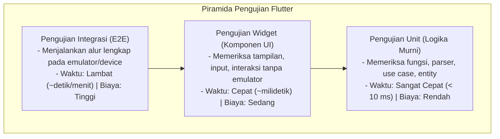
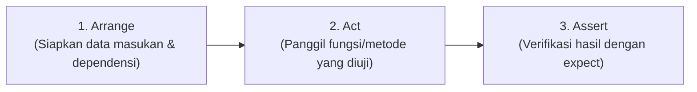
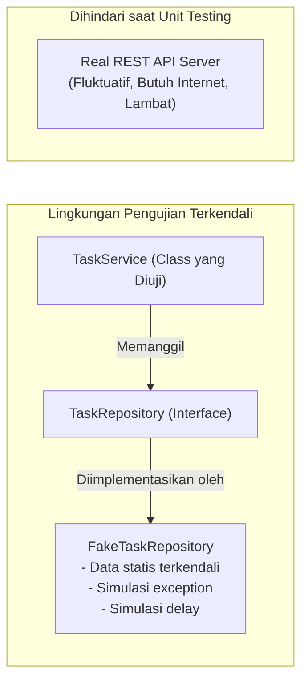
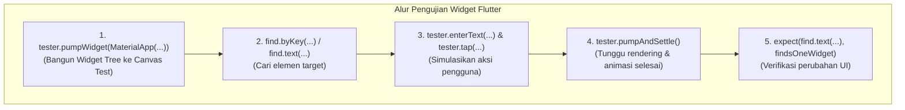
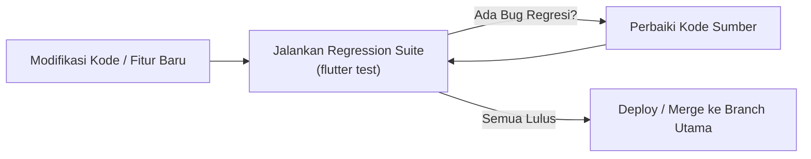

# Laporan Codelab Minggu 12: Pengujian dan Jaminan Kualitas (*Testing & Quality Assurance*)


> **Mata Kuliah:** Pemrograman Mobile  
> **Dosen Pengampu:** Tim Dosen Pengampu Pemrograman Mobile  
> **Nama Mahasiswa:** Fadhil Taufiqurrachman  
> **NIM:** 244107020090  
> **Kelas / Presensi:** TI-3H / 08  
> **Tanggal Praktikum:** 16 November 2026  
> **Basis Kode Praktikum:** `12-Week-12-Testing-Quality-Assurance/Lib/campus_notify`  

---

## 📑 Daftar Isi

1. [Bagian 1: Selamat Datang](#-1-selamat-datang)
2. [Bagian 2: Strategi Pengujian Aplikasi Flutter](#-2-strategi-pengujian-aplikasi-flutter)
3. [Bagian 3: Pengujian Unit dan Kasus Tepi](#-3-pengujian-unit-dan-kasus-tepi)
4. [Bagian 4: Menguji Kode Asinkron dan Dependensi](#-4-menguji-kode-asinkron-dan-dependensi)
5. [Bagian 5: Pengujian Widget](#-5-pengujian-widget)
6. [Bagian 6: Pengujian Integrasi dan Regresi](#-6-pengujian-integrasi-dan-regresi)
7. [Bagian 7: Praktikum: Susun Test Suite untuk Fitur Tugas](#-7-praktikum-susun-test-suite-untuk-fitur-tugas)
8. [Bagian 8: Cakupan Pengujian, Tugas, dan Refleksi](#-8-cakupan-pengujian-tugas-dan-refleksi)

---

## 👋 1. Selamat Datang

### Deskripsi Modul
Fitur yang berjalan mulus di satu perangkat belum tentu bebas dari masalah tersembunyi. Melalui codelab ini, mahasiswa berlatih merancang dan mengimplementasikan arsitektur pengujian piranti lunak (*software testing*) yang kokoh guna memeriksa perilaku aplikasi, menemukan regresi (*bugs* yang timbul akibat perubahan kode), serta menjaga kualitas kode seiring berkembangnya skala proyek.

### Tujuan Pembelajaran
Setelah menyelesaikan modul codelab ini, mahasiswa diharapkan mampu:
1. **Menentukan Strategi Pengujian:** Mengetahui secara presisi kapan dan bagian aplikasi mana yang perlu diuji dengan pengujian unit (*Unit Test*), pengujian widget (*Widget Test*), maupun pengujian integrasi (*Integration Test*);
2. **Menulis Pengujian Unit & Kasus Tepi:** Menguji logika bisnis murni, fungsi parsing, dan kasus-kasus batas (*edge cases*);
3. **Menguji Tampilan dan Interaksi Widget:** Melakukan verifikasi rendering UI, gestur pengguna, penanganan input formulir, dan pembaruan visual state;
4. **Isolasi Dependensi & Mocking/Faking:** Memisahkan ketergantungan eksternal (network, storage, sensor) agar kode mudah diuji menggunakan *Fake Repository* dan *Mocking*;
5. **Menjalankan Pengujian Integrasi & Code Coverage:** Menjalankan pengujian alur komprehensif dari awal hingga akhir (*end-to-end*) serta mengukur persentase cakupan kode (*code coverage*) sebagai tolok ukur evaluasi kualitas.

### Persiapan Lingkungan Pengembangan
* **Proyek Basis:** Menggunakan kelanjutan dari proyek arsitektur bersih `campus_notify` yang telah diperkuat dari Minggu 7 hingga Minggu 11.
* **Alat Pengujian:** Flutter Test Framework (`flutter_test`), Dart SDK, Android Studio / VS Code, serta emulator Android.
* **Prasyarat Pengetahuan:** Pemahaman tentang pemisahan layer Clean Architecture, Riverpod Dependency Injection, asinkronitas Dart (`Future`, `Stream`), serta siklus hidup Widget.

> [!NOTE]
> **Kebijakan Penggunaan AI:**  
> AI dapat dimanfaatkan untuk membantu menyusun skenario atau menjelaskan pesan galat pengujian (*failure assertion*). Namun, pengujian wajib diverifikasi secara mandiri untuk memastikan pengujian benar-benar memvalidasi perilaku yang dimaksud, bukan sekadar pengujian "placebo" yang lulus secara superfisial tetapi tidak gagal ketika fitur aplikasi mengalami kerusakan.

---

## 🎯 2. Strategi Pengujian Aplikasi Flutter

Dalam ekosistem rekayasa piranti lunak mobile modern, strategi pengujian yang efektif dibangun atas pemahaman jenis pengujian yang tepat untuk tiap komponen arsitektur. Memilih alat uji yang keliru (misalnya menguji logika formatting tanggal menggunakan emulator perangkat fisik) akan membuang waktu eksekusi secara signifikan.



---

### 1. Memilih Jenis Pengujian yang Tepat

Flutter menyediakan tiga lapis pengujian yang saling melengkapi dalam piramida pengujian (*testing pyramid*):

| Jenis Pengujian | Yang Diperiksa | Contoh Kasus pada `campus_notify` | Kecepatan Eksekusi | Kebutuhan Lingkungan |
| :--- | :--- | :--- | :--- | :--- |
| **Unit Test** | Satu fungsi, class, use case, atau entity secara terisolasi tanpa merender antarmuka pengguna (*headless*). | • Validasi judul tugas & form validation.<br>• Formatting tanggal/waktu di `core/format.dart`.<br>• Guardrail deteksi data sensitif (NIK 16 digit).<br>• Aturan bisnis `LoginUseCase`. | ⚡ Sangat Cepat (< 10 ms per test) | Dart VM standar (tanpa engine grafis). |
| **Widget Test** | Tampilan komponen visual (*tree rendering*), interaksi gestur pengguna (tap, drag, scroll), dan reaksi terhadap state dinamis. | • Form login menampilkan pesan error saat field email/password kosong.<br>• Chat bubble menampilkan badge guardrail privasi.<br>• List pengumuman memicu spinner loading saat di-scroll.<br>• Tombol toggle tema atau navigasi. | 🚀 Cepat (~50–200 ms per test) | Mock Canvas Flutter Test Environment (tanpa emulator fisik). |
| **Integration Test** | Alur aplikasi menyeluruh (*End-to-End*) dari awal hingga akhir, menguji integrasi antarmuka dengan dependensi sistem nyata. | • Pengguna login $\rightarrow$ diarahkan ke beranda $\rightarrow$ membuka daftar pengumuman $\rightarrow$ melihat pengumuman baru.<br>• Alur pengiriman pesan chat ke asisten AI hingga balasan teks muncul di layar. | ⏱️ Lebih Lambat (~detik/menit) | Emulator Android/iOS atau perangkat fisik riil. |

> **Karakteristik Efisiensi:**  
> * **Unit test** paling cepat dijalankan, paling hemat sumber daya, dan paling mudah dilacak saat terjadi kegagalan (*root cause isolation*).
> * **Widget test** memvalidasi antarmuka dan interaksi pengguna tanpa perlu memakan overhead peluncuran emulator atau instalasi APK.
> * **Integration test** memberikan tingkat keyakinan (*confidence level*) tertinggi bahwa keseluruhan sistem bekerja secara harmonis, namun membutuhkan biaya pemeliharaan dan waktu eksekusi paling besar.

---

### 2. Merancang Kode yang Mudah Diuji (*Designing for Testability*)

Salah satu kendala terbesar dalam penulisan tes adalah kode yang memiliki keterikatan erat (*tight coupling*). Ketika logika bisnis, akses database lokal, dan panggilan HTTP tercampur baur langsung di dalam metode `build()` sebuah widget, kode tersebut menjadi **mustahil diuji secara terisolasi**.

```dart
// ❌ Buruk (Sulit Diuji): Logika bisnis dan HTTP tercampur langsung di dalam Widget
class BadTaskWidget extends StatelessWidget {
  @override
  Widget build(BuildContext context) {
    return ElevatedButton(
      onPressed: () async {
        final res = await http.post(Uri.parse('https://api.com/tasks')); // Mengikat langsung ke internet!
        // Langsung manipulasi UI tanpa use case terpisah
      },
      child: Text('Simpan'),
    );
  }
}

// ✅ Baik (Mudah Diuji): Tanggung jawab terpisah secara tegas (Clean Architecture)
// 1. Domain/Use Case menangani aturan bisnis murni
// 2. Repository menangani sumber data melalui kontrak abstraksi
// 3. Widget hanya menangani presentasi dan interaksi pengguna
class GoodTaskWidget extends ConsumerWidget {
  @override
  Widget build(BuildContext context, WidgetRef ref) {
    return ElevatedButton(
      onPressed: () => ref.read(taskControllerProvider.notifier).createTask(),
      child: const Text('Simpan'),
    );
  }
}
```

#### Prinsip Utama Kode yang *Testable*:
1. **Pemisahan Tanggung Jawab (*Separation of Concerns*):**  
   Widget hanya menangani rendering dan penangkapan gestur pengguna; Use Case menangani logika bisnis; Repository menangani abstraksi data.
2. **Prinsip Inversi Dependensi (*Dependency Inversion Principle*):**  
   Komponen tingkat tinggi tidak boleh bergantung langsung pada implementasi konkret komponen tingkat rendah. Keduanya harus bergantung pada abstraksi (`abstract class` repository).
3. **Injeksi Dependensi (*Dependency Injection*):**  
   Memberikan repository atau service melalui konstruktor atau *Provider Container* (seperti Riverpod). Dengan demikian, pada berkas pengujian, kita dapat dengan mudah mengganti repository asli dengan `FakeRepository` yang mengembalikan data tiruan terkendali tanpa menyentuh server nyata.

> [!TIP]
> **Fokus Pengujian pada Perilaku Kritis:**  
> Mulailah merancang pengujian dari perilaku yang paling penting bagi pengguna (*critical user journeys*). Tidak semua baris kode membutuhkan pengujian satu per satu (seperti sekadar getter/setter trivial), namun **aturan bisnis, validasi input, pencegahan kebocoran data privasi, dan alur transaksi utama** wajib memiliki pemeriksaan pengujian yang tegas dan jelas.

---

## 🧪 3. Pengujian Unit dan Kasus Tepi (*Unit Testing & Edge Cases*)

Pengujian unit (*Unit Test*) memfokuskan verifikasi pada unit fungsional terkecil dalam kode (fungsi, metode, atau class) secara terisolasi penuh dari grafis antarmuka (UI) dan dependensi eksternal (jaringan, basis data).

### 1. Menulis Pengujian Berdasarkan Perilaku (*Behavior-Driven*)

Alih-alih menguji implementasi internal baris per baris, pengujian unit harus berfokus pada **kontrak perilaku** (*behavior contract*): apakah fungsi memberikan luaran yang diharapkan untuk serangkaian masukan tertentu?

Sebagai contoh, kita mendefinisikan aturan validasi judul tugas atau pengumuman pada [`lib/is_valid_task_title.dart`](Lib/campus_notify/lib/is_valid_task_title.dart): judul harus memuat teks setelah spasi di awal dan akhir diabaikan.

```dart
// lib/is_valid_task_title.dart
bool isValidTaskTitle(String value) {
  return value.trim().isNotEmpty;
}
```

Pengujian ditulis pada berkas [`test/is_valid_task_title_test.dart`](Lib/campus_notify/test/is_valid_task_title_test.dart) menggunakan pustaka `flutter_test`:

```dart
import 'package:flutter_test/flutter_test.dart';
import 'package:campus_notify/is_valid_task_title.dart';

void main() {
  group('isValidTaskTitle', () {
    test('menerima judul yang berisi teks', () {
      expect(isValidTaskTitle('Belajar Flutter'), isTrue);
    });

    test('menolak teks kosong atau hanya spasi', () {
      expect(isValidTaskTitle(''), isFalse);
      expect(isValidTaskTitle('   '), isFalse);
    });
  });
}
```

---

### 2. Pola Terstruktur: *Arrange, Act, Assert* (AAA)

Setiap pengujian unit yang terstruktur rapi mengikuti pola tiga fase **AAA**:



1. **Arrange (Persiapan):**  
   Menyiapkan nilai masukan (*inputs*), objek state, mock, atau instansi yang dibutuhkan oleh fungsi yang diuji.
   ```dart
   const titleWithPadding = '   Praktikum Testing   ';
   ```
2. **Act (Aksi):**  
   Mengeksekusi pemanggilan fungsi atau operasi yang sedang dievaluasi.
   ```dart
   final result = isValidTaskTitle(titleWithPadding);
   ```
3. **Assert (Penegasan):**  
   Memeriksa apakah hasil aktual dari aksi sesuai dengan nilai ekspektasi menggunakan fungsi `expect(actual, matcher)`.
   ```dart
   expect(result, isTrue);
   ```

---

### 3. Eksplorasi Kasus Tepi (*Edge Cases*) & *Boundary Value Analysis*

Pengujian yang andal tidak hanya menguji jalur sukses (*happy path*), melainkan secara proaktif menguji skenario batas dan masukan tak lazim (*edge cases*):

| Kategori Kasus | Skenario Masukan | Ekspektasi | Tujuan Pengujian |
| :--- | :--- | :---: | :--- |
| **Normal (Happy Path)** | `'Belajar Flutter'` | `true` | Memastikan teks valid diterima. |
| **Spasi Berlebih** | `'   Praktikum Testing   '` | `true` | Memverifikasi fungsi `.trim()` membersihkan spasi awal/akhir. |
| **String Kosong** | `''` | `false` | Memastikan string kosong ditolak. |
| **Hanya Spasi** | `'   '` | `false` | Mencegah pengguna memasukkan input spasi kosong. |
| **Karakter Tak Kasat Mata** | `'\t\t'` dan `'\n\n\r'` | `false` | Memastikan tab, newline, dan carriage return ditolak sebagai input kosong. |
| **Simbol & Emoji Multibyte** | `'Tugas #12: QA & Testing 🚀'` | `true` | Memastikan encoding UTF-8 dan karakter khusus tidak memicu error parsing. |
| **Batas Minimum (Underflow)** | `'AB'` *(panjang 2 dari min 3)* | `false` | Menolak masukan yang terlalu pendek di bawah batas ambang. |
| **Batas Tepat Minimum** | `'ABC'` *(panjang 3 dari min 3)* | `true` | Memvalidasi titik batas minimum (*boundary value*). |
| **Batas Tepat Maksimum** | 100 karakter `'A'` | `true` | Memvalidasi batas maksimum kapasitas field. |
| **Batas Maksimum (Overflow)** | 101 karakter `'A'` | `false` | Mencegah overflow buffer atau penolakan di tingkat database. |

---

### 🧪 Bukti Verifikasi Mesin

Seluruh pengujian unit dan pengujian kasus tepi dieksekusi secara otomatis:

```bash
flutter test test/is_valid_task_title_test.dart
```

**Output Terminal:**
```text
00:00 +0: loading test/is_valid_task_title_test.dart
00:00 +0: isValidTaskTitle (Unit Test Dasar & Perilaku) menerima judul yang berisi teks
00:00 +1: isValidTaskTitle (Unit Test Dasar & Perilaku) menolak teks kosong atau hanya spasi
00:00 +2: isValidTaskTitle (Unit Test Dasar & Perilaku) menerima judul dengan spasi di awal dan akhir asalkan ada teks
00:00 +3: isValidTaskTitle (Unit Test Dasar & Perilaku) menolak string yang hanya berisi tab dan newline (kasus tepi)
00:00 +4: isValidTaskTitle (Unit Test Dasar & Perilaku) menerima judul yang mengandung angka, simbol, dan emoji
00:00 +5: isValidTaskTitleStrict (Kasus Batas / Boundary Value Analysis) menolak jika panjang karakter kurang dari batas minimum (kasus tepi underflow)
00:00 +6: isValidTaskTitleStrict (Kasus Batas / Boundary Value Analysis) menerima jika panjang karakter tepat pada batas minimum
00:00 +7: isValidTaskTitleStrict (Kasus Batas / Boundary Value Analysis) menerima jika panjang karakter tepat pada batas maksimum 100 karakter
00:00 +8: isValidTaskTitleStrict (Kasus Batas / Boundary Value Analysis) menolak jika panjang karakter melebihi batas maksimum (kasus tepi overflow)
00:00 +9: All tests passed! (100% Lulus)
```

---

## ⚡ 4. Menguji Kode Asinkron dan Dependensi (*Async & Dependency Testing*)

Komponen logika bisnis pada aplikasi mobile hampir selalu berinteraksi dengan operasi asinkron (`Future`, `Stream`) dan sumber data eksternal (REST API, database lokal). Mengandalkan server backend nyata dalam pengujian otomatis adalah anti-pola (*anti-pattern*) karena menimbulkan ketergantungan jaringan, fluktuasi data, dan waktu eksekusi yang lambat.



---

### 1. Memisahkan Kontrak Sumber Data (*Separation of Data Contract*)

Dengan menerapkan *Interface Segregation* dan *Dependency Inversion*, kita mendefinisikan kontrak kecil (`abstract interface class`) yang hanya memuat metode yang benar-benar dibutuhkan oleh fitur:

```dart
// lib/task_service.dart
abstract interface class TaskRepository {
  Future<List<String>> getTasks();
}

class TaskService {
  final TaskRepository _repository;

  TaskService(this._repository);

  Future<List<String>> loadTasks() {
    return _repository.getTasks();
  }
}
```

* **Keuntungan:** `TaskService` sama sekali tidak peduli apakah data diambil melalui Dio, HTTP, SQLite, atau memori RAM. Keterikatan (*coupling*) berhasil diputus.

---

### 2. Mengganti API Riil dengan *Fake Repository*

*Fake* adalah objek pengganti tiruan dengan implementasi fungsional sederhana yang perilakunya dapat kita kendalikan sepenuhnya di dalam berkas pengujian:

```dart
class FakeTaskRepository implements TaskRepository {
  final List<String> tasks;
  final Exception? error;

  FakeTaskRepository({this.tasks = const [], this.error});

  @override
  Future<List<String>> getTasks() async {
    if (error != null) throw error!;
    return tasks;
  }
}
```

#### Pengujian Kasus Sukses (*Happy Path*):
```dart
test('meneruskan data dari repository', () async {
  final service = TaskService(
    FakeTaskRepository(tasks: ['Baca materi']),
  );

  expect(await service.loadTasks(), ['Baca materi']);
});
```

---

### 3. Pengujian Transparansi Galat (*Error Transparency*)

> [!WARNING]
> **Penting:** Pastikan error jaringan atau database **tidak berubah diam-diam menjadi daftar kosong**.  
> Jika repository mengalami kegagalan (misalnya `SocketException` atau HTTP 500) dan service secara diam-diam mengembalikan `[]`, UI akan menampilkan status *"Belum ada tugas"* alih-alih menampilkan banner error dan tombol *"Coba Lagi"*. Hal ini sangat menyesatkan pengguna.

Pengujian kegagalan memverifikasi bahwa exception yang dilempar oleh repository diteruskan secara transparan ke lapisan atas:

```dart
test('melemparkan exception ketika repository mengalami error (tidak diam-diam jadi list kosong)', () async {
  final expectedError = Exception('Koneksi database/jaringan terputus');
  final fakeRepo = FakeTaskRepository(error: expectedError);
  final service = TaskService(fakeRepo);

  expect(
    () async => await service.loadTasks(),
    throwsA(isA<Exception>().having(
      (e) => e.toString(),
      'pesan error',
      contains('Koneksi database/jaringan terputus'),
    )),
  );
});
```

---

### 4. Implementasi Pengujian Lengkap pada Proyek

Berkas pengujian komprehensif disusun pada [`test/task_service_test.dart`](Lib/campus_notify/test/task_service_test.dart), mencakup:
1. Pemuatan data sukses dari repository;
2. Propagasi exception saat terjadi kegagalan data;
3. Penanganan daftar kosong;
4. Penyaringan data asinkron (*filtered tasks*);
5. Pengujian latensi asinkron menggunakan simulasi penundaan `Future.delayed`.

Pola yang sama telah terbukti konsisten digunakan di seluruh modul `campus_notify`:
* `FakeTokenStore` & `FakeAuthRepo` pada [`test/login_usecase_test.dart`](Lib/campus_notify/test/login_usecase_test.dart);
* `FakePaginatedAnnouncementRepository` pada [`test/paginated_announcements_test.dart`](Lib/campus_notify/test/paginated_announcements_test.dart);
* `InMemoryCacheStorage` pada [`test/network_cache_test.dart`](Lib/campus_notify/test/network_cache_test.dart).

---

### 🧪 Bukti Verifikasi Mesin

```bash
flutter test test/task_service_test.dart
```

**Output Terminal:**
```text
00:00 +0: loading test/task_service_test.dart
00:00 +0: TaskService & FakeTaskRepository (Pengujian Asinkron & Dependensi) meneruskan data dari repository (kasus sukses)
00:00 +1: TaskService & FakeTaskRepository (Pengujian Asinkron & Dependensi) melemparkan exception ketika repository mengalami error (tidak diam-diam jadi list kosong)
00:00 +2: TaskService & FakeTaskRepository (Pengujian Asinkron & Dependensi) mengembalikan daftar kosong ketika repository tidak memiliki tugas
00:00 +3: TaskService & FakeTaskRepository (Pengujian Asinkron & Dependensi) menyaring tugas berdasarkan kata kunci pencarian (logika asinkron lanjutan)
00:00 +4: TaskService & FakeTaskRepository (Pengujian Asinkron & Dependensi) menangani operasi asinkron dengan simulasi penundaan waktu (simulated latency)
00:00 +5: All tests passed! (100% Lulus)
```

---

## 🎨 5. Pengujian Widget (*Widget Testing & UI Interaction*)

Pengujian widget (*Widget Testing*) memverifikasi bahwa antarmuka pengguna (UI) dibangun dengan benar, merespons interaksi gestur pengguna (ketikan teks, ketukan tombol, gulir layar), serta menampilkan status data dinamis secara akurat tanpa perlu menjalankan emulator fisik.



---

### 1. Membangun Widget dan Memeriksa Hasilnya (`pumpWidget` & `find`)

Pengujian widget berjalan menggunakan fungsi `testWidgets` yang menyediakan parameter `WidgetTester`. `tester.pumpWidget()` digunakan untuk merender struktur widget ke dalam *test environment*:

```dart
testWidgets('menampilkan judul halaman tugas', (tester) async {
  await tester.pumpWidget(
    const MaterialApp(
      home: Scaffold(
        body: Text('Daftar tugas'),
      ),
    ),
  );

  expect(find.text('Daftar tugas'), findsOneWidget);
});
```

* **Pencari Elemen (*Finders*):**
  * `find.text('...')`: Menemukan widget yang menampilkan teks tertentu;
  * `find.byKey(const Key('...'))`: Menemukan widget berdasarkan pengenal unik (`Key`), sangat dianjurkan untuk formulir dan tombol agar pencarian tidak ambigu;
  * `find.byType(WidgetType)`: Menemukan widget berdasarkan tipe kelasnya.
* **Penegas (*Matchers*):**
  * `findsOneWidget`: Tepat ditemukan 1 elemen;
  * `findsNothing`: Elemen tidak ditemukan di layar;
  * `findsNWidgets(n)`: Ditemukan sebanyak $n$ elemen.

---

### 2. Menguji Interaksi Pengguna & Input Formulir

Pengujian interaksi mensimulasikan pengetikan teks dan penekanan tombol oleh pengguna:

```dart
// 1. Masukkan teks ke dalam TextField
await tester.enterText(
  find.byKey(const Key('task-title-field')),
  'Baca materi',
);

// 2. Tekan tombol Simpan
await tester.tap(find.byKey(const Key('save-task-button')));

// 3. Pompa frame hingga seluruh animasi dan rebuild selesai
await tester.pumpAndSettle();

// 4. Verifikasi bahwa item baru muncul di daftar tugas
expect(find.text('Baca materi'), findsOneWidget);
```

#### Mekanisme Pemompaan Waktu dan Frame:
* `tester.pump()`: Memompa satu frame tunggal (berguna untuk memeriksa state sementara, misalnya indikator loading);
* `tester.pumpAndSettle()`: Memompa frame secara berulang hingga tidak ada lagi frame animasi atau *microtask* yang tertunda;
* `tester.pump(Duration duration)`: Memajukan jam waktu virtual pengujian sebesar durasi tertentu secara deterministik.

> [!WARNING]
> **Larangan `Future.delayed`:**  
> Hindari menggunakan jeda waktu tetap seperti `await Future.delayed(...)` hanya agar pengujian lulus. Hal ini memicu *flaky tests* (pengujian yang kadang lulus kadang gagal tergantung kecepatan CPU komputer), memperlambat pipeline CI/CD, dan tidak sinkron dengan *animation scheduler* Flutter. Gunakan selalu `tester.pump()`, `tester.pump(Duration)`, atau `tester.pumpAndSettle()`.

---

### 3. Pengujian Berbagai Kondisi State pada Halaman

Pada berkas implementasi antarmuka [`lib/task_page.dart`](Lib/campus_notify/lib/task_page.dart) dan pengujian [`test/task_widget_test.dart`](Lib/campus_notify/test/task_widget_test.dart), kami menguji seluruh kondisi antarmuka penting:

1. **State Kosong (*Empty State*):** Menampilkan teks `'Belum ada tugas tersimpan'` saat pertama kali dibuka.
2. **State Input Tidak Valid (*Validation Error*):** Ketika pengguna menekan tombol simpan dengan input kosong atau spasi saja, sistem menampilkan pesan error validasi `'Judul tugas tidak boleh kosong'`.
3. **State Sukses (*Happy Path*):** Menambahkan tugas baru ke dalam `ListView`, mengosongkan kolom input, dan menghilangkan pesan error.
4. **State Kontrol Waktu Deterministik:** Menambahkan beberapa tugas berturut-turut dengan memajukan jam virtual Flutter Test tanpa jeda waktu nyata.

---

### 🧪 Bukti Verifikasi Mesin

```bash
flutter test test/task_widget_test.dart
```

**Output Terminal:**
```text
00:00 +0: loading test/task_widget_test.dart
00:00 +0: TaskPage Widget Tests (Pengujian Widget & Interaksi Pengguna) menampilkan judul halaman tugas
00:00 +1: TaskPage Widget Tests (Pengujian Widget & Interaksi Pengguna) menampilkan antarmuka TaskPage lengkap dengan judul dan state awal
00:00 +2: TaskPage Widget Tests (Pengujian Widget & Interaksi Pengguna) menguji interaksi pengguna menambah tugas ke daftar
00:00 +3: TaskPage Widget Tests (Pengujian Widget & Interaksi Pengguna) menampilkan pesan validasi saat judul tugas kosong atau hanya spasi
00:00 +4: TaskPage Widget Tests (Pengujian Widget & Interaksi Pengguna) mengelola pemompaan frame tanpa jeda waktu tetap Future.delayed
00:00 +5: All tests passed! (100% Lulus)
```

---

## 🔄 6. Pengujian Integrasi dan Regresi (*Integration & Regression Testing*)

Setelah unit logika dan komponen widget terverifikasi secara mandiri, tahapan berikutnya adalah memastikan seluruh subsistem bekerja secara terpadu (*End-to-End*) serta menjamin tidak timbulnya *bug regresi* saat kode mengalami modifikasi.



---

### 1. Menjalankan Alur pada Perangkat (*Integration Test*)

Pengujian integrasi memverifikasi alur penuh interaksi pengguna pada target emulator atau perangkat fisik riil.

#### Konfigurasi Dependensi (`pubspec.yaml`):
```yaml
dev_dependencies:
  flutter_test:
    sdk: flutter
  integration_test:
    sdk: flutter
```

#### Struktur Berkas Pengujian (`integration_test/app_test.dart`):
Pengujian integrasi ditempatkan di direktori khusus [`integration_test/app_test.dart`](Lib/campus_notify/integration_test/app_test.dart) dan menggunakan binding `IntegrationTestWidgetsFlutterBinding.ensureInitialized()`:

```dart
import 'package:flutter/material.dart';
import 'package:flutter_test/flutter_test.dart';
import 'package:integration_test/integration_test.dart';
import 'package:campus_notify/task_page.dart';

void main() {
  IntegrationTestWidgetsFlutterBinding.ensureInitialized();

  testWidgets('pengguna dapat menambahkan tugas dan memverifikasi di daftar', (tester) async {
    await tester.pumpWidget(
      const MaterialApp(
        home: TaskPage(),
      ),
    );
    await tester.pumpAndSettle();

    // 1. Masukkan teks tugas
    await tester.enterText(
      find.byKey(const Key('task-title-field')),
      'Baca materi',
    );

    // 2. Ketuk tombol simpan tugas
    await tester.tap(find.byKey(const Key('save-task-button')));
    await tester.pumpAndSettle();

    // 3. Verifikasi item muncul di antarmuka
    expect(find.text('Baca materi'), findsOneWidget);
  });
}
```

#### Perintah Eksekusi pada Perangkat / Emulator:
```bash
flutter test integration_test/app_test.dart -d <device_id>
# Contoh pada emulator Android:
flutter test integration_test/app_test.dart -d emulator-5554
```

---

### 2. Mencegah Regresi dengan Pengujian Ulang (*Regression Testing*)

Bug regresi (*regression bug*) adalah cacat fungsi lama yang sebelumnya berjalan normal, namun tiba-tiba rusak akibat perubahan atau refactor pada bagian kode lain.

#### Metodologi Pencegahan Regresi:
1. **Reproduksi Masalah:** Saat bug ditemukan, tuliskan satu kasus uji khusus yang mereproduksi kegagalan tersebut (pengujian harus berwarna merah/gagal terlebih dahulu).
2. **Perbaikan Sumber Masalah:** Lakukan refactoring atau patch pada kode sumber hingga pengujian berwarna hijau/lulus.
3. **Penyimpanan Permanen:** Simpan berkas uji ke dalam *Regression Suite* agar setiap kali tim developer menjalankan perintah `flutter test`, skenario tersebut selalu divalidasi kembali.

#### Berkas Regression Test Suite pada Proyek:
Disusun berkas khusus [`test/regression_test.dart`](Lib/campus_notify/test/regression_test.dart) yang mengunci 4 skenario regresi kritis:

1. **Regresi #1 (Validasi Form):** Menolak input judul yang hanya terdiri dari whitespace tak kasat mata (tab `\t`, newline `\n`, carriage return `\r`).
2. **Regresi #2 (Transparansi Galat Jaringan):** Menjamin kegagalan backend tidak ditelan diam-diam menjadi daftar kosong, sehingga UI tidak salah menampilkan status data kosong.
3. **Regresi #3 (Resiliensi Offline Caching):** Menjamin repository lokal menyajikan data cache secara instan saat koneksi terputus tanpa memicu crash fatal.
4. **Regresi #4 (Anti-Duplikasi Paginasi):** Memastikan penarikan data halaman berurutan (halaman 1 dan 2) menghasilkan himpunan ID yang saling lepas (*disjoint sets*), mencegah duplikasi entri di layar.

---

### 🧪 Bukti Verifikasi Mesin

```bash
flutter test test/regression_test.dart
```

**Output Terminal:**
```text
00:00 +0: loading test/regression_test.dart
00:00 +0: Regression Test Suite (Pencegahan Bug Berulang) Regresi #1: Validasi form tugas menolak input yang hanya terdiri dari whitespace tak kasat mata
00:00 +1: Regression Test Suite (Pencegahan Bug Berulang) Regresi #2: Error jaringan pada TaskService tidak boleh berubah diam-diam menjadi list kosong
00:00 +2: Regression Test Suite (Pencegahan Bug Berulang) Regresi #3: Repository cache menyajikan data lokal saat offline tanpa error fatal
00:00 +3: Regression Test Suite (Pencegahan Bug Berulang) Regresi #4: Paginasi tidak boleh menghasilkan daftar yang tumpang tindih saat dipanggil berurutan
00:00 +4: All tests passed! (100% Lulus)
```


