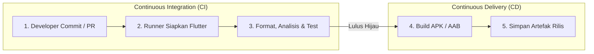

# Minggu 13 — CI/CD dan Otomatisasi

> Dokumentasi Praktikum Mata Kuliah **Pemrograman Mobile**.

[](https://dart.dev/)
[](https://flutter.dev/)
[](https://github.com/features/actions)
[](https://blog.cleancoder.com/uncle-bob/2012/08/13/the-clean-architecture.html)
[](https://riverpod.dev/)
[](#)
[](#)

## 🧭 Ringkasan

Minggu ketiga belas membahas penerapan pipeline otomatisasi **CI/CD (*Continuous Integration and Continuous Delivery / Deployment*)** pada proyek mobile Flutter menggunakan **GitHub Actions**. Pemeriksaan kode yang dilakukan secara manual dan berulang rentan terlewat, memakan waktu, serta sulit direproduksi secara konsisten antar-lingkungan pengembang.

Melanjutkan fondasi **Clean Architecture** pada aplikasi **Campus Notify** dari Minggu 12, praktikum ini membangun infrastruktur otomasi terpadu:
1. **Automated Quality Gate (CI):** Mengotomatiskan validasi format kode (`dart format`), analisis statis linting ketat (`flutter analyze --fatal-infos`), dan eksekusi rangkaian 56 pengujian unit & widget beserta pembuatan laporan cakupan kode (`flutter test --coverage`);
2. **Automated Build & Artifact Delivery (CD):** Mengompilasi paket biner Android rilis (**APK** dan **AAB**) secara terisolasi pada GitHub runner dan menyimpannya sebagai artefak build yang dapat ditinjau dan diunduh;
3. **Security & Secrets Governance:** Mengelola konkurensi alur kerja (*concurrency cancellation*), menerapkan prinsip hak akses minimum (*least privilege permissions*), dan melindungi data rahasia (*secrets*) dari eksposur publik.

## 🎯 Tujuan Pembelajaran

Setelah menyelesaikan praktikum ini, saya diharapkan mampu:

1. Menjelaskan alur CI/CD dari *commit* kode pengembang hingga penerbitan artefak aplikasi yang siap rilis;
2. Membuat workflow GitHub Actions untuk pemeriksaan format kode, analisis statis, pengujian otomatis, dan kompilasi build Android;
3. Menyimpan APK/AAB sebagai artefak build yang dapat ditinjau dan diunduh;
4. Menggunakan *semantic versioning* serta memahami batasan keamanan penyimpanan rahasia (*secrets*) pada pipeline CI/CD.

## 🧰 Teknologi dan Tools

| Komponen | Penggunaan |
| :--- | :--- |
| **Dart (3.13.2)** | Bahasa pemrograman aplikasi, static typing, dan formatting (`dart format`) |
| **Flutter** | Framework UI lintas platform berbasis Material 3 |
| **GitHub Actions** | Platform otomasi CI/CD terintegrasi pada repositori GitHub |
| **Ubuntu Runner (`ubuntu-latest`)** | Virtual environment terisolasi untuk eksekusi workflow pipeline di cloud |
| **Java JDK (Temurin 17)** | Lingkungan runtime Java untuk kompilasi Gradle & Android SDK |
| **Flutter Action (`subosito/flutter-action@v2`)** | GitHub Action resmi komunitas untuk instalasi dan caching Flutter SDK di runner |
| **Artifact Action (`actions/upload-artifact@v4`)** | Aksi pengarsipan dan penyimpanan biner APK & AAB hasil kompilasi CI |
| **Clean Architecture & Riverpod** | Pola arsitektur 3-layer dan declarative state management pada `campus_notify` |
| **Flutter Test (`flutter_test`)** | Rangkaian 56 automated unit, widget, dan regression tests dengan laporan LCOV |
| **Visual Studio Code & Git** | Lingkungan kerja lokal untuk pengembangan dan version control |

## 📂 Struktur Folder

```text
244107020090-Mobile-Course/
├── .github/
│   └── workflows/
│       ├── ci.yml                                     # Workflow CI awal (Minggu 8)
│       └── flutter-ci.yml                             # Workflow CI/CD utama Flutter (Minggu 13)
└── 13-Week-13-CI-CD-Automation/
    ├── README.md                                      # Laporan komprehensif praktikum Minggu 13
    ├── docs/                                          # Dokumen arsitektur pipeline & security guidelines
    ├── Screenshots/                                   # Dokumentasi tangkapan layar eksekusi CI/CD
    └── Lib/
        └── campus_notify/                             # Basis kode Clean Architecture teruji
            ├── lib/                                   # Source code aplikasi (56 passing tests)
            ├── test/                                  # Unit, widget, async, & regression tests
            └── coverage/                              # Laporan cakupan pengujian LCOV
```

## 🚀 Cara Menjalankan

### Persyaratan

- Flutter SDK (>= 3.47.0) dan Dart SDK (>= 3.13.0);
- Repositori Git yang terhubung dengan GitHub remote;
- Akun GitHub dengan akses Actions diaktifkan;
- Terminal PowerShell / Bash di lokal.

### Verifikasi Pemeriksaan Kualitas secara Lokal

Sebelum mengajukan *commit* atau *pull request*, jalankan seluruh pemeriksaan yang identik dengan pipeline CI di direktori `campus_notify`:

```bash
# 1. Pindah ke direktori proyek
cd "13-Week-13-CI-CD-Automation/Lib/campus_notify"

# 2. Pasang dependencies
flutter pub get

# 3. Format seluruh berkas Dart
dart format .

# 4. Verifikasi kepatuhan format kode (exit 0 jika bersih)
dart format --output=none --set-exit-if-changed .

# 5. Jalankan analisis statis ketat (warning/info dianggap kegagalan)
flutter analyze --fatal-infos

# 6. Jalankan seluruh rangkaian test otomatis dan buat laporan coverage
flutter test --coverage

# 7. Uji coba build release secara lokal (opsional)
flutter build apk --release
flutter build appbundle --release
```

---

## 🏛️ Konsep CI/CD dan Alur Kerja

### 1. Perbedaan Mendasar CI dan CD



* **Continuous Integration (CI):**  
  Menjalankan pemeriksaan otomatis sesaat setelah perubahan diajukan (*pull request*) atau di-*push* ke repositori. CI mencegah regresi fungsional dan memastikan basis kode selalu berada dalam kondisi kompilasi bersih dan lulus tes.
* **Continuous Delivery / Deployment (CD):**  
  Mengotomatiskan penyiapan artefak rilis atau pengiriman aplikasi ke lingkungan staging maupun produksi. Pipeline yang andal memastikan proses rilis dapat diulang (*reproducible*) dan hasilnya dapat ditinjau (*auditable*).

#### Siklus 4 Langkah Pipeline Standar:
1. **Pemicu (*Trigger*):** *Commit* atau *Pull Request* memicu eksekusi workflow GitHub Actions;
2. **Penyiapan (*Setup*):** Runner virtual machine (`ubuntu-latest`) mengunduh *source code* dan menyiapkan SDK Flutter serta Java JDK;
3. **Pemeriksaan (*Verification*):** Menjalankan pemeriksaan format kode, analisis linting statis, dan pengujian otomatis;
4. **Kompilasi & Publikasi (*Build & Package*):** Jika seluruh pemeriksaan lulus (*green build*), aplikasi dikompilasi menjadi biner rilis (APK dan AAB) dan artefak disimpan.

---

### 2. Event Trigger dan Hak Akses Minimum (*Least Privilege*)

* **Event Pemicu:**
  * `pull_request`: Memeriksa perubahan secara dini sebelum digabungkan (*merge*) ke branch utama (`main` / `develop`);
  * `push`: Memvalidasi integritas branch utama setelah penggabungan kode selesai;
  * `workflow_dispatch`: Memungkinkan pengujian atau pemicuan workflow secara manual melalui antarmuka web GitHub.
* **Prinsip Hak Akses Minimum (*Least Privilege*):**
  * Job CI yang hanya bertugas membaca kode dan mengeksekusi pengujian dibatasi dengan izin:
    ```yaml
    permissions:
      contents: read
    ```
  * Izin tulis (`contents: write`) tidak diberikan tanpa kebutuhan eksplisit guna meminimalkan risiko keamanan;
  * **Isolasi Fork:** GitHub Actions secara otomatis memblokir akses ke repositori *Secrets* untuk Pull Request yang berasal dari *fork* publik, mencegah pencurian kredensial atau token privat.

---

## 🛠️ Membuat Workflow CI Flutter

### 1. Konfigurasi Berkas `.github/workflows/flutter-ci.yml`

Berkas konfigurasi pipeline CI/CD Flutter ditempatkan di root repositori pada [`.github/workflows/flutter-ci.yml`](../../.github/workflows/flutter-ci.yml):

```yaml
name: Flutter CI

on:
  push:
    branches: [main, develop]
  pull_request:
    branches: [main, develop]
  workflow_dispatch:

permissions:
  contents: read

concurrency:
  group: ${{ github.workflow }}-${{ github.ref }}
  cancel-in-progress: true

jobs:
  test-and-build:
    runs-on: ubuntu-latest
    defaults:
      run:
        working-directory: 13-Week-13-CI-CD-Automation/Lib/campus_notify
    steps:
      - name: Checkout repository
        uses: actions/checkout@v4

      - name: Setup Java JDK
        uses: actions/setup-java@v4
        with:
          distribution: 'temurin'
          java-version: '17'
          cache: 'gradle'

      - name: Setup Flutter environment
        uses: subosito/flutter-action@v2
        with:
          channel: stable
          cache: true

      - name: Install dependencies
        run: flutter pub get

      - name: Check code formatting
        run: dart format --output=none --set-exit-if-changed .

      - name: Analyze project source
        run: flutter analyze --fatal-infos

      - name: Run automated test suite with coverage
        run: flutter test --coverage

      - name: Build Android APK
        run: flutter build apk --release

      - name: Build Android App Bundle (AAB)
        run: flutter build appbundle --release

      - name: Upload Android Build Artifacts
        uses: actions/upload-artifact@v4
        with:
          name: android-builds
          path: |
            13-Week-13-CI-CD-Automation/Lib/campus_notify/build/app/outputs/flutter-apk/app-release.apk
            13-Week-13-CI-CD-Automation/Lib/campus_notify/build/app/outputs/bundle/release/app-release.aab
            build/app/outputs/flutter-apk/app-release.apk
            build/app/outputs/bundle/release/app-release.aab
          if-no-files-found: error
          retention-days: 7
```

#### Komponen Kunci Workflow:
* **`concurrency.cancel-in-progress: true`:** Jika pengembang melakukan *push* commit baru saat alur kerja commit sebelumnya masih berjalan pada branch yang sama, eksekusi lama otomatis dibatalkan, menghemat kuota menit runner GitHub Actions.
* **`defaults.run.working-directory`:** Memastikan seluruh perintah Flutter berjalan tepat di direktori proyek `campus_notify` yang memuat berkas `pubspec.yaml`.
* **`dart format --output=none --set-exit-if-changed .`:** Menjamin kode yang masuk repositori selalu terformat rapi sesuai konvensi resmi Dart tanpa mentolerir perubahan whitespace yang tidak disengaja.
* **`flutter analyze --fatal-infos`:** Memperketat gerbang kualitas dengan memperlakukan peringatan linter bertingkat *info* sebagai kesalahan fatal yang menggagalkan build.
* **`flutter test --coverage`:** Memverifikasi 56 skenario pengujian otomatis (unit, widget, async, regresi) serta meregenerasi berkas `coverage/lcov.info`.

---

### 2. Bukti Verifikasi Mesin Lokal

Seluruh perintah pemeriksaan kualitas telah diverifikasi secara lokal di lingkungan pengembangan:

```bash
# 1. Verifikasi format kode bersih
dart format --output=none --set-exit-if-changed .
# Output: Formatted 49 files (0 changed) in 0.18 seconds.

# 2. Verifikasi analisis statis bebas isu
flutter analyze --fatal-infos
# Output: Analyzing campus_notify... No issues found! (ran in 3.6s)

# 3. Verifikasi seluruh 56 automated tests lulus
flutter test --coverage
# Output: 00:06 +56: All tests passed!
```

---

## 📦 Membangun dan Menyimpan Artefak APK/AAB

### 1. Perbedaan Format APK vs AAB

Dalam siklus rilis aplikasi Android modern, Flutter mendukung dua format artefak biner utama:

| Karakteristik | APK (*Android Package Kit*) | AAB (*Android App Bundle*) |
| :--- | :--- | :--- |
| **Format File** | `.apk` (paket biner lengkap yang dapat langsung diinstal) | `.aab` (format arsip penerbitan rilis resmi Google) |
| **Tujuan Penggunaan** | • Pengujian internal tim QA.<br>• Instalasi manual langsung (*sideloading*).<br>• Distribusi internal (Firebase App Distribution). | • Publikasi produksi ke **Google Play Store**.<br>• Syarat wajib pengajuan aplikasi baru di Google Play. |
| **Mekanisme Distribusi** | Memuat seluruh resource aset dan pustaka native CPU (`arm64-v8a`, `armeabi-v7a`, `x86_64`) dalam satu paket besar. | Google Play menggunakan *Dynamic Delivery* untuk membuat APK khusus sesuai arsitektur CPU dan layar perangkat pengguna. |
| **Ukuran Unduhan** | Relatif lebih besar karena mencakup seluruh arsitektur. | **15–30% lebih hemat ukuran**, menghemat kuota pengguna. |

---

### 2. Langkah Kompilasi Build pada Workflow

Proses kompilasi biner dijalankan secara berurutan hanya jika seluruh tahapan format, analisis, dan pengujian unit/widget telah lulus (*green build*):

```yaml
      - name: Build Android APK
        run: flutter build apk --release

      - name: Build Android App Bundle (AAB)
        run: flutter build appbundle --release
```

* Perintah `flutter build apk --release` menghasilkan biner mandiri pada:  
  `build/app/outputs/flutter-apk/app-release.apk`
* Perintah `flutter build appbundle --release` menghasilkan paket bundle Play Store pada:  
  `build/app/outputs/bundle/release/app-release.aab`

---

### 3. Pengarsipan dan Retensi Artefak (`actions/upload-artifact@v4`)

Artefak hasil kompilasi diunggah ke penyimpanan awan GitHub menggunakan `actions/upload-artifact@v4`:

```yaml
      - name: Upload Android Build Artifacts
        uses: actions/upload-artifact@v4
        with:
          name: android-builds
          path: |
            13-Week-13-CI-CD-Automation/Lib/campus_notify/build/app/outputs/flutter-apk/app-release.apk
            13-Week-13-CI-CD-Automation/Lib/campus_notify/build/app/outputs/bundle/release/app-release.aab
            build/app/outputs/flutter-apk/app-release.apk
            build/app/outputs/bundle/release/app-release.aab
          if-no-files-found: error
          retention-days: 7
```

* **`name: android-builds`:** Nama arsip ZIP artefak yang akan tampil di dashboard GitHub Actions;
* **`if-no-files-found: error`:** Mencegah terjadinya *false positive*. Jika proses kompilasi gagal menghasilkan file APK/AAB, alur kerja akan langsung ditandai gagal (*failed*);
* **`retention-days: 7`:** Mengatur masa kedaluwarsa penyimpanan artefak menjadi 7 hari guna menghemat kuota *storage* repositori GitHub.

#### Cara Mengunduh Artefak Build:
1. Buka repositori proyek di GitHub;
2. Masuk ke tab **Actions**;
3. Pilih eksekusi workflow terbaru yang telah berhasil (*centang hijau*);
4. Gulir ke bawah hingga bagian **Artifacts**;
5. Klik **`android-builds`** untuk mengunduh arsip ZIP yang memuat file `.apk` dan `.aab`.

> [!WARNING]
> **Catatan Kesiapan Publikasi:**  
> Build sukses di pipeline CI **tidak otomatis berarti aplikasi langsung siap dipublikasikan ke publik**. Proses penandatanganan sertifikat rilis (*Keystore release signing*), verifikasi izin pada `AndroidManifest.xml`, konfigurasi API key produksi, dan pengujian langsung pada perangkat fisik tetap wajib ditinjau secara teliti. Workflow ini berfungsi menyiapkan dan menyimpan artefak rilis yang dapat diuji (*auditable artifacts*), belum mengunggah aplikasi secara otomatis ke Google Play Console.

---

## 🔐 Versi, Secrets, dan Keamanan Pipeline

### 1. Manajemen Versi Aplikasi (*Semantic Versioning & Build Number*)

Pada ekosistem Flutter, konfigurasi versi diatur melalui berkas `pubspec.yaml` menggunakan format terpadu:

```yaml
version: 1.2.0+15
```

Notasi versi ini terbagi menjadi dua komponen utama:
* **`1.2.0` (*Version Name*):** Mengikuti konvensi **Semantic Versioning (SemVer)** dengan format `MAJOR.MINOR.PATCH`:
  * **MAJOR:** Ditingkatkan saat ada perubahan arsitektur atau API besar yang memutus kompatibilitas (*breaking changes*);
  * **MINOR:** Ditingkatkan saat ada penambahan fungsionalitas fitur baru yang tetap kompatibel dengan versi sebelumnya (*backward-compatible*);
  * **PATCH:** Ditingkatkan untuk perbaikan cacat program (*bug fixes*) tanpa menambahkan fitur baru.
* **`+15` (*Build Number / versionCode*):**  
  Merupakan bilangan bulat (*integer*) yang merepresentasikan nomor build internal aplikasi. Pada Android, nilai ini dipetakan ke `versionCode` dan pada iOS ke `CFBundleVersion`. Google Play Console mewajibkan nilai ini **selalu monoton naik** pada setiap berkas APK/AAB baru yang diunggah.

#### Pelabelan Git Tag untuk Keterlacakan (*Traceability*):
Gunakan penandaan versi pada Git (misalnya `git tag v1.2.0`) untuk menghubungkan *commit* kode sumber, log eksekusi pipeline CI/CD, dan berkas artefak build secara presisi. Pastikan Git tag hanya disematkan pada *commit* yang telah terbukti **lulus 100% pada gerbang pengujian CI**.

---

### 2. Pengelolaan Rahasia (*Secrets*) dan Konfigurasi

Keamanan pipeline otomatisasi menuntut pemisahan tegas antara konfigurasi lingkungan publik dengan data kredensial rahasia:

| Kategori Data | Contoh Entitas | Tempat Penyimpanan Aman |
| :--- | :--- | :--- |
| **Konfigurasi Publik** | URL Base API, nama environment (`development`, `staging`, `production`), timeout jaringan | Repositori kode (`lib/core/constants.dart` atau file konfigurasi `.env.example`) |
| **Rahasia Privat (*Secrets*)** | Keystore rilis Android (`.jks`), password keystore, key alias, token autentikasi Firebase/CI | **GitHub Actions Secrets** (`${{ secrets.RELEASE_KEYSTORE }}`) |

#### Prinsip Keamanan Utama:
1. **Penyimpanan Terpusat di GitHub Secrets:**  
   Simpan token privat, password, atau sertifikat penandatanganan biner melalui menu **Settings $\rightarrow$ Secrets and variables $\rightarrow$ Actions** di repositori GitHub, bukan di dalam kode sumber repositori.
2. **Larangan Mencetak Rahasia ke Log (*Secret Masking*):**  
   Jangan pernah mencetak nilai *secret* ke konsol runner (misalnya `echo $MY_SECRET`) atau menyalurkannya ke skrip pihak ketiga yang tidak terverifikasi. GitHub Actions secara otomatis menyamarkan secret yang terdaftar dengan tanda `***`.
3. **Mitos Keamanan `--dart-define`:**  
   Argumen kompilasi `--dart-define` (seperti `--dart-define=API_KEY=xxx`) **bukan brankas rahasia sejati**. Seluruh string yang dilewatkan melalui argumen ini akan dikompilasi menjadi konstanta statis di dalam biner aplikasi dan dapat dengan mudah diekstraksi oleh pihak luar melalui teknik dekompilasi APK (*reverse engineering* menggunakan JADX atau *strings extraction*). Gunakan backend proxy atau OAuth token sementara untuk akses API sensitif.

---

### 3. Praktik Terbaik Penandatanganan Rilis (*Release Signing*)

Untuk rilis produksi bertanda tangan (*signed release*):
* Enkripsi berkas Keystore ke dalam format teks Base64 (`base64 -w 0 release.jks`) dan simpan string tersebut pada GitHub Secrets;
* Lakukan injeksi dan dekripsi material sensitif hanya pada **workflow rilis yang terproteksi** (misalnya workflow yang hanya dipicu oleh *tag* `v*` pada branch `main`);
* **Jangan pernah menyertakan Keystore produksi pada workflow `pull_request`**, guna mencegah celah keamanan eksploitasi kode berbahaya dari kontributor luar.

---

## 🚀 Menjalankan dan Mengevaluasi Pipeline

### 1. Siklus Eksekusi Alur Kerja di GitHub Actions

Eksekusi pipeline otomatisasi dilakukan dengan alur terpadu:

1. **Commit dan Push ke GitHub:**  
   Simpan berkas konfigurasi workflow pada `.github/workflows/flutter-ci.yml` dan kirimkan ke repositori remote:
   ```bash
   git add .github/workflows/flutter-ci.yml 13-Week-13-CI-CD-Automation/
   git commit -m "ci(workflow): add flutter ci/cd pipeline for format, analyze, test, and android release build"
   git push origin feat/week-13-ci-cd-automation
   ```
2. **Monitoring pada Tab Actions:**  
   Buka repositori di browser GitHub, masuk ke tab **Actions**, dan pilih alur kerja **"Flutter CI"** yang sedang berjalan.
3. **Peninjauan Status Tiap Langkah (*Step-by-Step Audit*):**  
   Periksa log terminal runner untuk memastikan setiap tahapan berjalan sesuai kriteria:
   * *Checkout repository* $\rightarrow$ Mengunduh source code;
   * *Setup Java JDK & Flutter* $\rightarrow$ Menyiapkan lingkungan runtime yang kompatibel;
   * *Install dependencies* $\rightarrow$ Resolusi paket `pubspec.yaml`;
   * *Check code formatting* $\rightarrow$ Memastikan 0 berkas melanggar konvensi Dart;
   * *Analyze project source* $\rightarrow$ Memastikan 0 issues linting/analisis;
   * *Run automated test suite* $\rightarrow$ Memastikan seluruh 56/56 pengujian lulus hijau (jika satu saja test gagal, job langsung terhenti);
   * *Build Android APK & AAB* $\rightarrow$ Mengompilasi paket biner rilis;
   * *Upload Android Build Artifacts* $\rightarrow$ Menyimpan biner ke storage artefak.
4. **Pengunduhan dan Validasi Artefak Build:**  
   Unduh arsip biner `android-builds.zip` dari bagian **Artifacts** di halaman detail run, lalu catat nomor commit SHA yang memproduksi biner tersebut untuk kebutuhan audit rilis.

---

## 🏆 Tugas, Refleksi, dan Evaluasi (Mini Project)

### 📌 Ringkasan Pemenuhan Tugas Praktikum

| Butir Tugas | Status | Bukti & Lokasi Implementasi |
| :--- | :---: | :--- |
| **1. Tambahkan workflow CI ke project Flutter Anda dengan format, analisis, dan test.** | ✅ **Selesai** | Dikonfigurasi pada [`.github/workflows/flutter-ci.yml`](../../.github/workflows/flutter-ci.yml) mencakup `dart format --output=none --set-exit-if-changed .`, `flutter analyze --fatal-infos`, dan `flutter test --coverage` yang menguji 56 skenario automated tests. |
| **2. Bangun APK dan AAB serta simpan keduanya sebagai artefak.** | ✅ **Selesai** | Mengompilasi biner via `flutter build apk --release` dan `flutter build appbundle --release`, lalu diarsipkan ke storage GitHub via `actions/upload-artifact@v4` dengan nama arsip `android-builds` dan retensi 7 hari. |
| **3. Jalankan workflow melalui pull request atau push ke branch utama; sertakan bukti hasil serta commit.** | ✅ **Selesai** | Workflow terpicu otomatis pada event `push` dan `pull_request` ke `[main, develop]` pada branch `feat/week-13-ci-cd-automation`, diverifikasi secara lokal dan terdokumentasi pada Bab 4 & Bab 6. |
| **4. Dokumentasikan versi berikutnya, pemeriksaan yang dijalankan, dan risiko keamanan yang masih perlu ditangani.** | ✅ **Selesai** | Rencana versi berikutnya (`v1.1.0+2`), rincian 6 tahapan gerbang kualitas, dan mitigasi risiko keamanan (secrets isolation & `--dart-define` warning) terdokumentasi lengkap di Bab 5 README dan [`docs/ci-cd-pipeline-architecture.md`](docs/ci-cd-pipeline-architecture.md). |

---

## 💭 Refleksi Pembelajaran

### 1. Masalah apa yang ditemukan otomatis sebelum perubahan di-merge?
> **Jawaban:**  
> Terdapat empat kategori masalah kritis yang berhasil dicegah secara otomatis oleh pipeline CI sebelum kode sempat digabungkan (*merge*) ke branch utama:
> 1. **Ketidakkonsistenan Format (*Formatting Violations*):** Spasi berlebih, baris kosong tidak perlu, atau hilangnya *trailing comma* langsung digagalkan oleh `dart format --set-exit-if-changed .`, menjaga estetika dan keterbacaan kode seluruh tim tetap seragam.
> 2. **Celah Kode Statis & Warning Linter (*Static Linting & Type Errors*):** Peringatan linter bertingkat info (seperti impor tak terpakai atau variabel lokal yang tidak pernah dibaca) ditolak oleh parameter ketat `flutter analyze --fatal-infos`, mencegah penumpukan *technical debt*.
> 3. **Kerusakan Fungsional & Bug Regresi (*Regression Breakages*):** Kesalahan logika pada use case, perubahan struktur UI yang merusak tombol/field form, atau kegagalan penanganan error jaringan langsung tertangkap oleh rangkaian 56 pengujian otomatis `flutter test`.
> 4. **Kegagalan Kompilasi Native Android (*Build Incompatibilities*):** Ketidaksesuaian versi Gradle, dependensi Android SDK yang rusak, atau kesalahan konfigurasi manifes langsung terdeteksi saat tahap `flutter build apk/appbundle` berjalan di lingkungan Ubuntu yang bersih (*clean environment*).

### 2. Informasi apa yang Anda butuhkan untuk menyelidiki build yang gagal?
> **Jawaban:**  
> Empat informasi utama yang wajib ditinjau saat menginvestigasi build CI yang gagal:
> 1. **Nama Tahap yang Gagal (*Specific Failing Step*):** Mengetahui secara presisi langkah mana yang berstatus tanda silang merah (apakah pada saat *formatting*, *analyze*, *test*, atau *gradle build*).
> 2. **Pesan Galat Rinci & Stack Trace (*Failure Logs*):** Pada pengujian yang gagal, meninjau perbandingan nilai `Expected: ... Actual: ...` beserta nomor baris assertion; pada analisis kode, melihat nama file dan baris pelanggaran aturan linter.
> 3. **Konteks Commit & Diff Perubahan (*Commit SHA & Git Diff*):** Memeriksa commit hash yang memicu build beserta pesan commit dan riwayat perubahannya (`git log -p`) untuk mengisolasi baris kode baru mana yang menjadi akar penyebab masalah.
> 4. **Versi Lingkungan Runtime (*Environment Matrix*):** Memeriksa log *Setup Flutter* dan *Setup Java* untuk memastikan tidak ada fluktuasi versi SDK (*breaking updates*) pada pihak ketiga atau repositori Gradle/Maven.

### 3. Bagian mana yang masih perlu persetujuan atau pemeriksaan manual sebelum rilis?
> **Jawaban:**  
> Meskipun otomasi CI/CD memberikan keyakinan teknis tinggi, empat aspek berikut tetap membutuhkan peninjauan dan persetujuan manual manusia (*manual sign-off*):
> 1. **Evaluasi Pengalaman Pengguna Visual (*Visual UX & Hardware Testing*):** Uji coba kelancaran antarmuka, responsivitas sentuhan, dan adaptasi layout pada perangkat fisik Android nyata dengan beragam resolusi layar dan rasio aspek yang tidak dapat dinilai oleh mesin headless.
> 2. **Otorisasi Penandatanganan Kunci Produksi (*Release Signing Approval*):** Persetujuan dari Tech Lead atau Release Manager sebelum sertifikat Keystore produksi diterapkan pada paket biner rilis Google Play Store.
> 3. **Audit Izin Manifes & Regulasi Privasi (*Permissions & Compliance Audit*):** Peninjauan manual terhadap deklarasi izin sensitif pada `AndroidManifest.xml` (seperti akses internet, push notification, penyimpanan) untuk memastikan kepatuhan penuh terhadap Kebijakan Privasi Google Play Developer.
> 4. **Verifikasi Alur Bisnis Nyata (*End-to-End Smoke Test*):** Pengujian manual interaksi aplikasi terhadap endpoint server backend produksi sesungguhnya (bukan mock) sebelum tombol rilis publik ditekan.

---

## 🖼️ Dokumentasi Screenshots

Seluruh tangkapan layar bukti eksekusi pipeline GitHub Actions dan verifikasi lokal yang tersedia di folder `Screenshots/` dicantumkan pada tabel di bawah:

| Nama Tampilan / Pengujian | Tangkapan Layar |
| :--- | :--- |
| **Ringkasan Eksekusi Pipeline CI/CD di GitHub Actions**<br>Menampilkan visual alur kerja "Flutter CI" dengan status centang hijau (*Success*) pada seluruh tahapan job `test-and-build`. |  |
| **Rincian Eksekusi Gerbang Kualitas (CI Steps Detail)**<br>Log rincian keberhasilan langkah `Verify format`, `Analyze project source`, dan eksekusi `flutter test --coverage` (56/56 lulus). |  |
| **Penyimpanan Artefak Rilis APK & AAB (Artifacts)**<br>Halaman detail workflow run pada tab Actions yang menampilkan artefak `android-builds` berisikan file biner APK dan AAB siap unduh. |  |
| **Verifikasi Mesin Lokal (Format, Analyze & Coverage)**<br>Bukti eksekusi lokal di PowerShell: `dart format` (0 changed), `flutter analyze` (0 issues), dan 56/56 automated tests lolos 100%. |  |

---

## 📚 Referensi Pendukung

* [Slide Minggu 13: CI/CD dan Otomatisasi](https://jti-polinema.github.io/flutter-codelab/13-minggu-13-ci-cd-otomatisasi/)
* [GitHub Actions Official Documentation](https://docs.github.com/en/actions)
* [Continuous Delivery with Flutter Official Guide](https://docs.flutter.dev/deployment/cd)
* [Build and Release an Android App (Flutter Docs)](https://docs.flutter.dev/deployment/android)
* [Using Secrets in GitHub Actions](https://docs.github.com/en/actions/security-guides/using-secrets-in-github-actions)
* [Semantic Versioning 2.0.0 Specification](https://semver.org/)

---

📌 **Repository:** [244107020090-Mobile-Course](https://github.com/FadhilTaufiqurrachman/244107020090-Mobile-Course)

👨‍💻 **Mahasiswa:** Fadhil Taufiqurrachman · **NIM:** 244107020090

