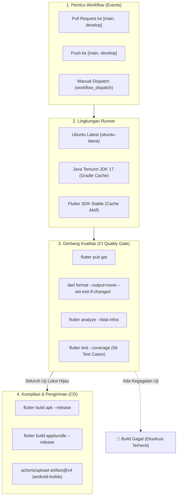

# Spesifikasi Arsitektur Pipeline CI/CD dan Keamanan

Dokumen ini mendefinisikan rancangan arsitektur pipeline otomatisasi **Continuous Integration & Continuous Delivery (CI/CD)** menggunakan **GitHub Actions** untuk proyek mobile Flutter **`campus_notify`** pada praktikum Minggu 13.

---

## 1. Topologi Pipeline Otomatisasi



---

## 2. Matriks Gerbang Kualitas (*Quality Gate*)

| Tahapan Pemeriksaan | Perintah Eksekusi | Kriteria Kelulusan | Dampak Kegagalan |
| :--- | :--- | :--- | :--- |
| **1. Konsistensi Format** | `dart format --output=none --set-exit-if-changed .` | 0 file berubah (exit code 0) | Mencegah komit dengan formatting tidak rapi atau spasi liar |
| **2. Analisis Kode Statis** | `flutter analyze --fatal-infos` | 0 issues (error, warning, info) | Mencegah kode tidak aman, unused import, dan potensi NPE |
| **3. Pengujian Otomatis** | `flutter test --coverage` | 56/56 tests passing (100% lulus) | Menolak regresi bug, validasi logika, dan kegagalan UI state |
| **4. Kompilasi APK Biner** | `flutter build apk --release` | Berkas `app-release.apk` terbentuk | Memverifikasi kompatibilitas build native Android |
| **5. Kompilasi AAB Bundle** | `flutter build appbundle --release` | Berkas `app-release.aab` terbentuk | Memverifikasi kesiapan bundle rilis Google Play Store |
| **6. Pengarsipan Artefak** | `actions/upload-artifact@v4` | ZIP `android-builds` tersimpan (7 hari) | Menyediakan biner terverifikasi untuk pengujian QA |

---

## 3. Strategi Versi (*Versioning Strategy*)

Aplikasi menggunakan skema standar Flutter yang mengawinkan **Semantic Versioning** dengan **Android Version Code**:

```yaml
version: 1.0.0+1
```

* **Version Name (`1.0.0`):** Ditampilkan kepada pengguna akhir di toko aplikasi dan menu About.
  * `MAJOR` (1): Perubahan antarmuka drastis atau arsitektur dasar.
  * `MINOR` (0): Penambahan fitur baru yang tetap kompatibel (misal fitur filter tugas atau AI assistant).
  * `PATCH` (0): Perbaikan bug minor atau optimasi performa.
* **Build Number (`+1`):** Bilangan bulat yang dipetakan langsung ke `versionCode` Android dan `CFBundleVersion` iOS. Nilai ini wajib selalu bertambah untuk setiap rilis baru yang diunggah.
* **Keterlacakan Git Tag:** Setiap rilis stabil di-tag dengan format `vMAJOR.MINOR.PATCH` (contoh: `v1.0.0`), mengunci commit SHA dengan artefak rilis.

---

## 4. Matriks Risiko Keamanan & Tata Kelola Rahasia

| Risiko Keamanan | Skenario Ancaman | Mitigasi yang Diterapkan di Pipeline |
| :--- | :--- | :--- |
| **Kebocoran Kunci API** | Kunci privat Gemini API atau Firebase terdorong ke repositori publik | Kunci tidak di-commit; disimpan di GitHub Actions Secrets atau diakses via secure backend proxy |
| **Penyalahgunaan `--dart-define`** | Developer mengira `--dart-define` aman dan menaruh secret produksi di dalamnya | Dokumentasikan bahwa `--dart-define` dapat diekstrak dari biner APK; hanya gunakan untuk konfigurasi non-sensitif |
| **Pencurian Keystore Rilis** | File Keystore (`.jks`) di-commit ke Git atau dibaca oleh PR kontributor asing | Keystore dienkripsi Base64 di GitHub Secrets; workflow `pull_request` tidak diberi akses ke Secrets |
| **Eskalasi Izin Runner** | Skrip pihak ketiga mencoba memanipulasi repositori atau merilis biner palsu | Terapkan prinsip hak akses minimum: `permissions: contents: read` |
| **Eksploitasi Kuota Runner** | Puluhan commit berulang memicu pemborosan jam komputasi runner | Terapkan `concurrency.cancel-in-progress: true` untuk membatalkan antrean usang secara otomatis |
